# The Map of Earth's Business

### I tried to count all the business on the planet. Every list I opened was hiding something.

Nvidia is worth about $5.2 trillion. That's more than India produces in a whole year, and more than Germany does.

You've probably seen comparisons like that. They're fun, and almost meaningless. A company's market value is a lake: a pile of money sitting still. A country's GDP is a river: money that flows past once a year. Measuring a lake against a river tells you nothing about either.

But it got me asking a simpler question, one I couldn't find a straight answer to anywhere:

**How much business is there on Earth? Who does it, and what do they actually do?**

I thought it would take a weekend. It took weeks. I pulled every serious list I could find: the Forbes Global 2000, the Fortune Global 500, sixty stock exchanges, the World Bank, the International Labour Organization, the unicorn trackers, venture capital and IPO reports. Then I matched them into one dataset of about 15,000 companies. (All of it is browsable on [the live site](https://abhijitdalal26.github.io/big-business-map/). Hover over any company in any chart and it tells you what that company actually does.)

Here's what I learned. Every list answers the question. And every list is hiding something. This essay is the story of following those hidden parts down, one layer at a time.

---

## Part 1: The answer everyone uses

When people say "big business," they almost always mean one list: the **Forbes Global 2000**, the 2,000 largest companies with shares on a stock exchange.

It's an impressive list. In the 2026 edition, those companies reported:

- **$56.0 trillion** in revenue
- **$5.5 trillion** in profit
- **$121.9 trillion** in market value
- **82.2 million** employees

World GDP is $111.7 trillion, so their combined revenue equals **half of everything the world produces in a year**. (Careful: that's a comparison of size, not a share. Revenue counts the same steel twice, once when the mill sells it and again when the carmaker sells the car. GDP counts it once.)

Some of them are bigger than countries. **Amazon's revenue ($743 billion) would rank about 22nd among the world's 204 economies**, between Poland and Belgium. Reliance Industries brings in more each year ($120 billion) than the GDP of 137 countries.

And they're concentrated. Rank the 2,000 by size, and count how many it takes to reach half the total:

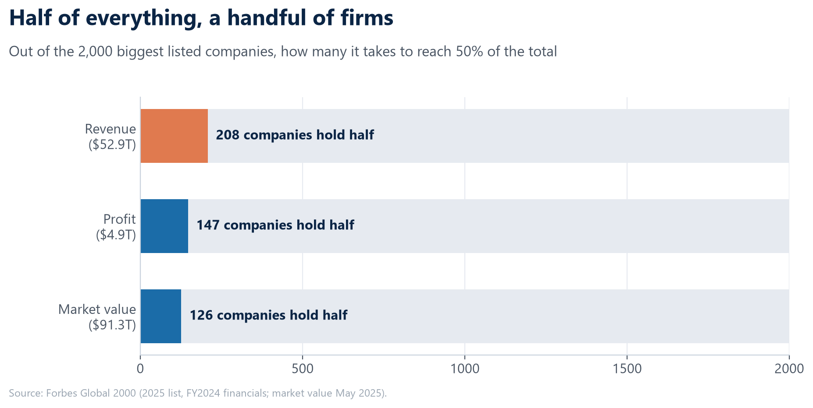

**207 companies make half the revenue. 135 make half the profit. Just 103 carry half the market value.** Each measure is more concentrated than the one before.

So that's the first answer: 2,000 companies, sales equal to half the world's output, run mostly by a few hundred.

But here's the first thing the list hides. Those 2,000 giants employ 82.2 million people. That's **2.2% of the world's workers. One worker in forty-five.**

That made me want to see the whole thing, not just the top:

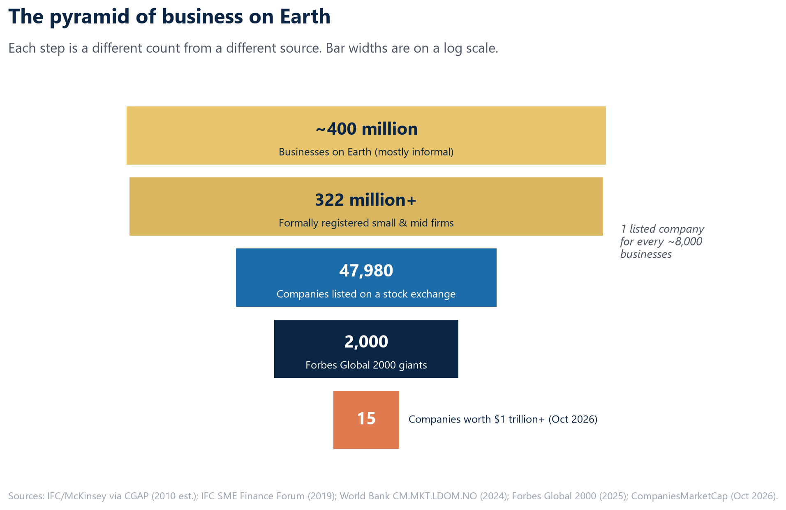
*Each level comes from a different source and year. Read it as orders of magnitude.*

There are roughly **400 million businesses** on Earth. Fewer than **48,000** are listed on a stock exchange: **one for every ~8,000 businesses**. The Global 2000 is the top 4% of those. At the very tip sit **15 companies worth more than $1 trillion**, twelve of them American.

The famous list is the tip of the tip. Before going down the pyramid, I wanted to understand the tip properly. What do these 2,000 companies actually *do*?

---

## Part 2: What the giants actually do (the ideas that won)

Strip away the logos and every company is an **idea about how to make money**:

- **Walmart:** buy in enormous volume, sell cheap, win on scale.
- **Costco:** sell at almost no profit, and make the money on membership fees.
- **Berkshire Hathaway:** take the cash customers pay for insurance and use it to buy whole companies.
- **Nvidia:** design the chips the AI boom runs on, and let someone else (TSMC) build the factories.
- **McKesson:** buy medicines in bulk from drugmakers and deliver them to every pharmacy in America. That idea brings in $403 billion a year, and almost nobody has heard of it.

I collected a one-line "what they actually do" for more than 2,000 of the biggest companies on Earth, listed and unlisted. Then I grouped them into the same kinds of business the [site's treemap](https://abhijitdalal26.github.io/big-business-map/) uses. Here are the ideas that won:

| The idea | How the money is made | Giants | Share of revenue | Share of value | Firms over $100B |
|---|---|---|---|---|---|
| **Money** | Hold other people's money and earn the spread | 563 | 21% | 17% | 20 |
| **Consumer & retail** | Make or stock what households buy; win on brand or volume | 205 | 16% | 11% | 17 |
| **Energy** | Dig up, refine or generate energy, sell it by the unit | 184 | 12% | 8% | 13 |
| **Tech** | Write code or design chips once, sell copies at almost no extra cost | 209 | 11% | **34%** | 11 |
| **Health** | Sell treatments, devices or insurance to people who can't say no | 109 | 8% | 7% | 8 |
| **Food** | Turn crops into branded food, or sell groceries | 94 | 5% | 3% | 3 |
| **Machines & defence** | Build the machines businesses and governments run on | 129 | 5% | 7% | **1** |
| **Building & property** | Build things that stay put, then own or rent them | 117 | 5% | 2% | 4 |
| **Materials** | Turn rocks, ores and oil into steel, cement, chemicals | 139 | 5% | 4% | **0** |
| **Services & trading** | Do work others don't want to, or buy and resell in bulk | 106 | 5% | 3% | 5 |
| **Telecom & media** | Own the pipes or the content; charge everyone who uses them | 61 | 3% | 2% | 5 |
| **Transport** | Move people and goods | 81 | 3% | 2% | **0** |

*Forbes Global 2000 (2026). Three firms filed as conglomerates or unclassified are left out.*

Two things jump out of that table.

**Some ideas scale to giants; some never do.** Money has 20 companies above $100 billion in revenue. Materials and transport have **none**, and machines just one (China's BYD). A steel mill or a trucking route doesn't get much cheaper just by getting bigger, so those industries stay split among many mid-sized firms.

**The boring ideas are the biggest.** Banks, shops and oil together are half of all giant-company revenue. Software, chips and AI, the ideas everyone talks about, are 11%.

And each country has managed to scale different ideas:

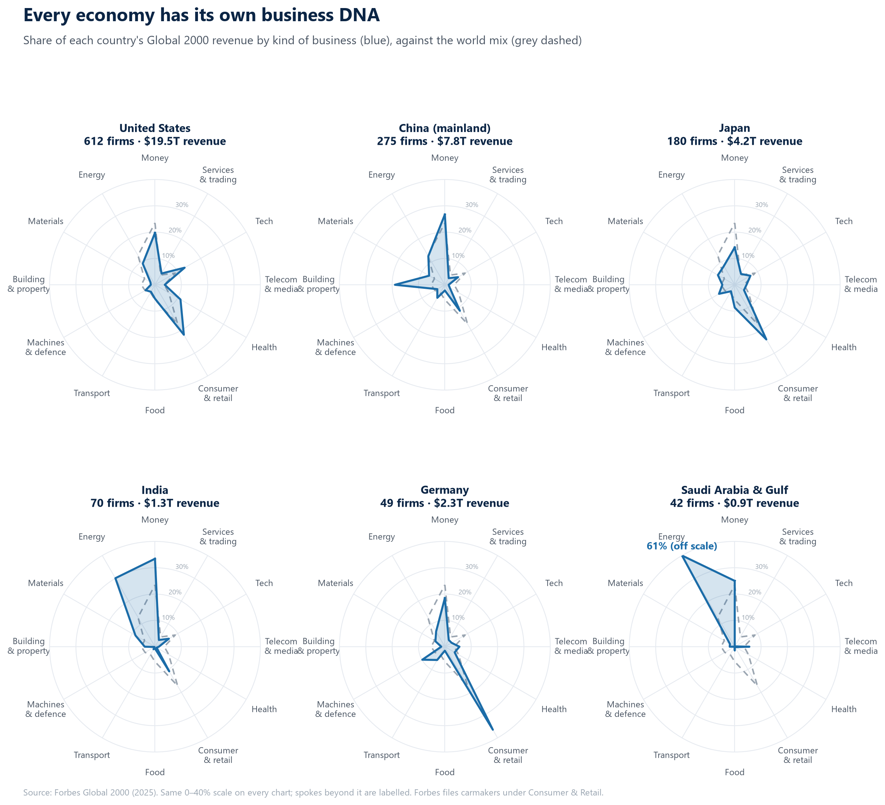

- **China** is a building economy: **16%** of its giants' revenue is construction and property, against 5% worldwide.
- **Germany** is a car economy: **36%** is consumer goods, which mostly means Volkswagen, Mercedes and BMW.
- **India** is a bank attached to an oil refinery: **money (33%) and energy (29%)** make up more than three-fifths.
- **The Gulf** runs on a single idea: **56%** energy.
- **The US** has the most balanced shape, tilted toward health (16%, twice the world mix) and tech. It's the only large economy where the newer ideas carry real weight.

That last point turned out to be the key to the next layer. Because when I put money in and value out on the same chart, the two didn't match at all.

---

## Part 3: What the market pays for

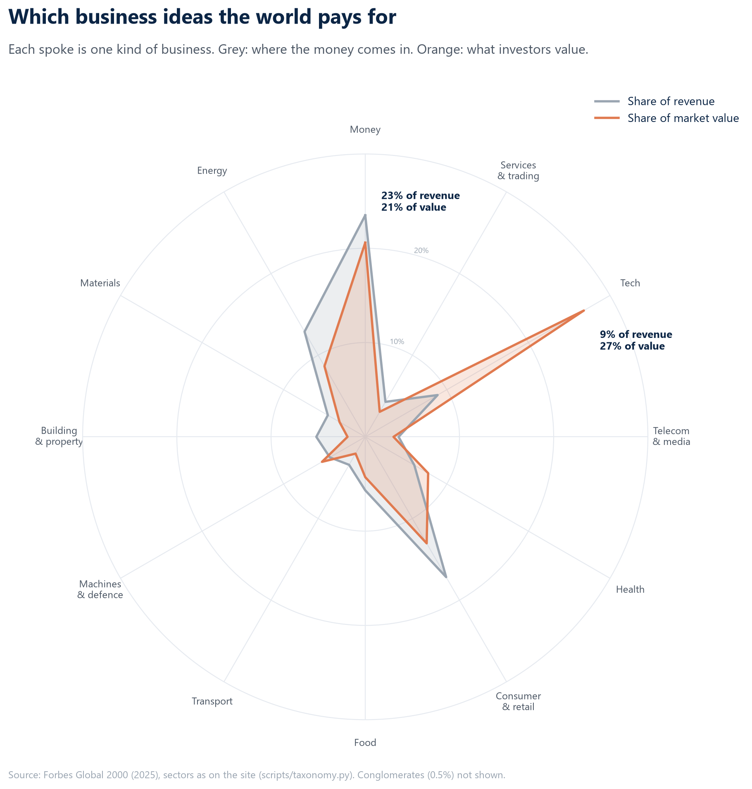

Grey is where the revenue comes from. Orange is what investors value. The shapes are almost opposite.

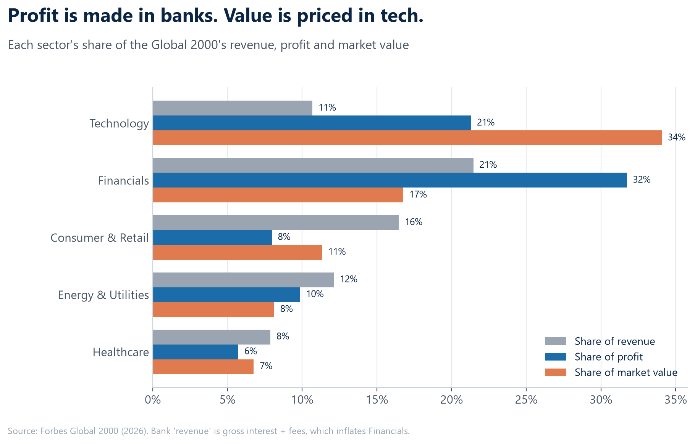

**Banks make 32% of all the profit but get 17% of the value. Tech makes 21% of the profit and gets 34% of the value**, a third of everything the 2,000 are worth. The market pays about **34 times profit for tech and 12 times for banks**. To an investor, one dollar of tech profit is worth about three dollars of bank profit.

That isn't crazy. A bank needs more capital for every new loan, while Microsoft can sell one more copy of Windows for almost nothing. Investors are betting tech profits keep growing and bank profits don't.

But follow that bet across the map and something else shows up. Because the ideas the market pays most for are mostly American:

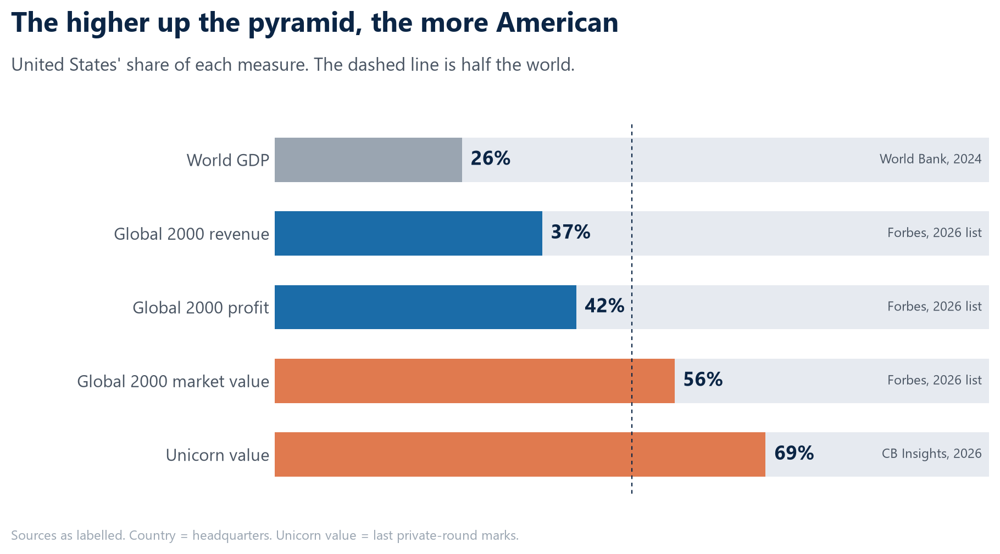

The US is 26% of the world economy. It has 37% of the giants' revenue, 42% of their profit, **56% of their market value**, and **69% of all unicorn value**. The closer you get to "what investors are excited about," the more American it gets.

Elsewhere the picture is the mirror image. The EU is 17% of world GDP and has 276 giants, but only **6% of unicorn value**. Europe builds big old companies, not new ones. Japan has 178 giants and just six unicorns. And Russia, 2% of the world economy, has **zero** companies on the list. After sanctions and delistings, it has simply vanished from it.

This has been building for a decade. Among today's biggest companies (the 1,252 with a full record from 2016 to 2025):

- **Profits more than doubled** (×2.2), while revenue grew 1.6×. Margins rose from 7.3% to 10%. Big business got richer faster than it got bigger.
- **Nvidia's revenue grew 31 times**, from $6.9 billion to $216 billion. Amazon climbed from 23rd to **1st** by revenue; Alphabet from 56th to 5th; Microsoft from 60th to 15th.
- **The US now has about 4,000 listed companies, half as many as in 1996**, yet its share of world stock-market value rose to 54%. Fewer companies, bigger ones, more American.

*(Caveat: these are today's survivors. Companies that collapsed, like Credit Suisse or Evergrande, aren't in the starting point, which flatters the growth.)*

And who owns all those shares? Increasingly, a handful of giant funds. **BlackRock alone manages $15.5 trillion**, about a tenth of the value of every stock market on Earth. Norway's oil fund holds $2.3 trillion, and **nine government funds now hold more than $1 trillion each**.

So the stock market's version of the economy is concentrated in a few ideas, a few companies, a few funds, and mostly one country.

But it has a bigger blind spot. The stock market can only see companies that have shares.

---

## Part 4: The giants with no ticker

To check, I took Fortune's Global 500, which ranks companies by revenue whether they're listed or not, and put it next to Forbes:

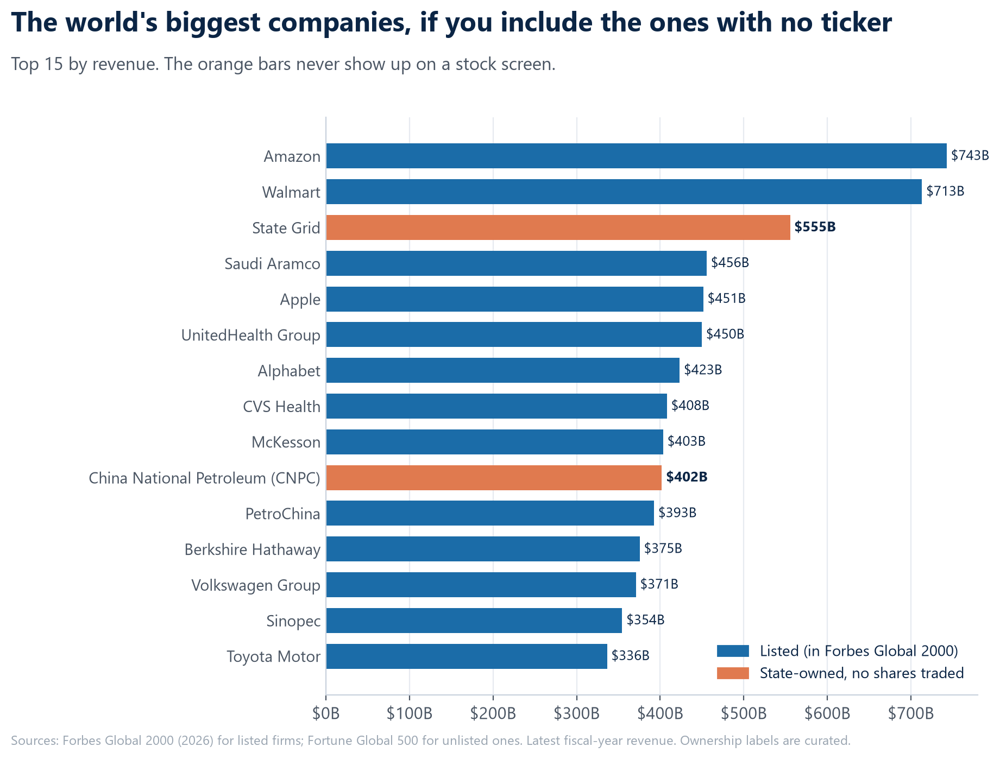

**The third-largest company on Earth doesn't appear on any stock screen.** China's **State Grid** brings in **$555 billion a year**. Only Amazon and Walmart sell more. China National Petroleum ($402B) is in the top 10 as well. Neither has a single share you can buy.

They're not alone:

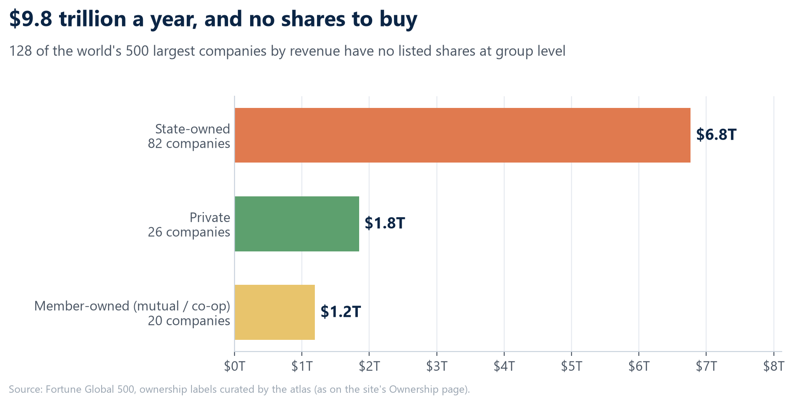

- **128 of the world's 500 largest companies have no listed shares** at group level. Together they bring in **$9.8 trillion** a year: 82 state-owned groups ($6.8T), 26 private firms ($1.8T) and 20 owned by their members ($1.2T).
- **About 23% of all their revenue** comes from companies a government controls. In China, it's 72 of its 111 giants. In the US, almost none.

Being state-owned doesn't automatically mean being unprofitable. Listed state firms like Saudi Aramco, ICBC and SBI have the **highest margins of any group (13%)**. The unlisted ones (power grids, railways, post offices, steel) run at **2.5%**. They do a different job, closer to public utilities than to businesses.

The rest of the invisible giants are private by choice:

- **Commodity traders.** Vitol and Trafigura move oil and metals around the world and disclose very little.
- **Family firms.** Cargill ($154B), Koch ($125B), Mars ($55B).
- **Partnerships.** The Big Four accounting firms (Deloitte, PwC, EY, KPMG) bring in ~$212B and appear on no stock list.
- **Foundations.** A charity controls Bosch (~94%), IKEA (100%) and Novo Nordisk (~77% of votes). India's version is the Tata Trusts, which own about two-thirds of Tata Sons.
- **Co-operatives.** About 3 million co-ops have more than a billion members and employ 280 million people. Adjusted for each country's income, the largest in the world is **Amul**, owned by 36 lakh dairy farmers in Gujarat.

So about a quarter of the biggest businesses on Earth answer to governments, families, charities or members, not to shareholders.

That's a big correction to the map. But even after adding every hidden giant, I was still only looking at the very top of the pyramid. The real surprise was further down.

---

## Part 5: Below every list

To see the 400 million businesses at the bottom of the pyramid, you have to stop looking at companies and look at people:

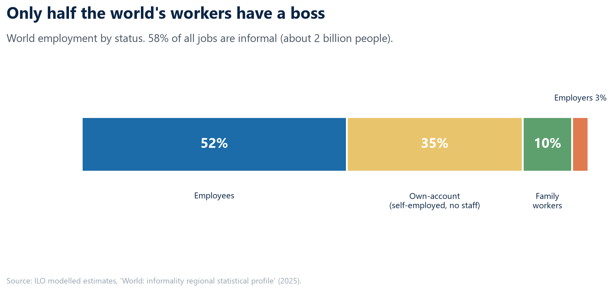

Only **52%** of the world's workers are employees, with a boss and a wage. **35%** work for themselves with no staff: the farmer, the rickshaw driver, the tailor working from home. **10%** work unpaid in a family business. **3%** are employers.

**58% of all jobs on Earth are informal**: no contract, no registration, no social security. That's about **2 billion people**. In low-income countries it's 88%. By the ILO's count, **84% of the world's economic units** are informal.

And the biggest occupation on the planet is almost completely missing from the lists:

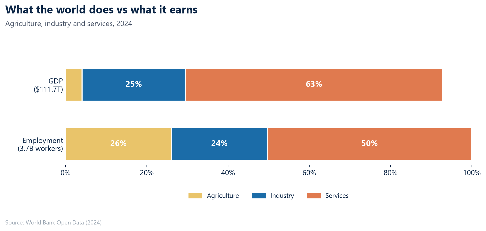

Farming is **4% of world GDP but 26% of world jobs**, about **964 million people**. Its share of the Global 2000 is essentially **zero**. No Forbes industry is farming. The closest companies are the grain traders and fertiliser makers that farmers buy from and sell to.

So here's the full picture of the bottom. The list that business news treats as "the economy" covers one worker in forty-five. The typical business on Earth isn't a company at all. It's one person, unregistered, often on a farm.

That's the economy as it is today. The last layer is where money is betting it's going next.

---

## Part 6: The new money

The newest layer is private companies backed by venture capital. There are now **1,442 unicorns** (private companies valued at $1 billion or more), worth a combined **$7.35 trillion** on paper.

"On paper" matters. A unicorn's value is the price of its last funding round, often a small slice of shares sold on special terms, sometimes years ago. Those values aren't prices anyone has paid for the whole company.

And the money has picked a side:

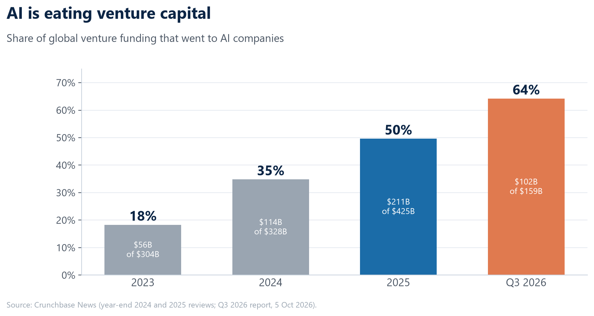

In 2023, AI took 18% of venture funding. By the third quarter of 2026, it took **64%**. Two companies, **Anthropic (~$965B) and OpenAI (~$840B)**, now account for about a quarter of all unicorn value.

The money is flowing at the top of the public markets too. **Global IPOs raised $290 billion in the first nine months of 2026**, more than double the year before, even though the number of listings fell. About $86 billion of that came from a single June listing. Mergers and acquisitions hit **$4.6 trillion in 2025**, the most since 2021.

Still, keep it in proportion. All 1,442 unicorns combined are worth about **5% of the world's listed market value**. That's about one and a half Apples. The new money is loud, but it's still small next to the old.

---

## Part 7: Where India sits on the map

I ran India through every layer, and the same pattern kept showing up: **India is big in count, smaller in size.**

- **64 companies in the Global 2000**: joint fifth in the world by count, but 9th by revenue. Indian giants average ~$21B in revenue, against ~$35B for American ones.
- **State-owned companies (PSUs) are 23 of those 64.** They bring in **44% of the revenue** but only **24% of the market value**. Their typical profit margins are the same as private firms' (about 13%). The market just pays less for them: about **9× profit for PSUs and 19× for private Indian giants**.
- **63 unicorns worth $144 billion**, 4th in the world. All of them together are worth less than Reliance Industries alone.
- **India has the most IPOs in the world**: 379 in 2025. But it raised about $12 billion in 2026, against $164 billion in the US. That's many small listings, mostly funded by Indian savers.
- Underneath it all: **87% of jobs are informal** and **75% of workers are self-employed** (in the US it's 6%). And the world's biggest farmer co-op, Amul.

India has scaled three ideas to global size: finance, oil and IT services. It hasn't yet scaled the ideas Germany, Japan and the US are built on: manufacturing, medicines and consumer brands. That gap is the most interesting thing on India's part of the map.

---

## The map, all at once

Remember the lake and the river?

Every list I used measures a lake: the companies big enough, listed enough or famous enough to be counted. And each lake is real. 2,000 companies with sales equal to half the world's output. About a hundred firms carrying half of all their market value. A state power grid that sells more than Apple. Two AI labs worth a quarter of all startups.

But the economy is a river, and most of it flows below every list:

1. **The famous list is thin.** 2,000 companies, 4% of listed firms, one worker in forty-five.
2. **Investors pay for a few ideas.** Tech makes 11% of the sales and carries 34% of the value, and most of it is American.
3. **Some of the biggest giants are invisible.** A quarter of the largest businesses answer to governments, families, charities or members.
4. **Most of the world's work happens below all of it.** 2 billion informal workers and nearly a billion farmers that no ranking counts.

The Forbes 2000 isn't wrong. It measures exactly what it says it measures. The mistake is treating it as the map.

*Next: [pick one: the invisible giants up close / why ideas like steel never make $100B companies / India's missing manufacturers].*

---

### How this was built

- **Sources:** Forbes Global 2000 (2026), Fortune Global 500, World Bank Open Data (2024), ILO (2025), CB Insights, Crunchbase, CompaniesMarketCap, SEC filings, EY Global IPO Trends, XBMA/LSEG, Global SWF, World Cooperative Monitor.
- **Matching:** about 18,000 rows were reconciled into one universe of **about 15,000 companies**.
- **Business ideas:** one-line descriptions for over 2,000 of the largest companies, extracted from Forbes and Wikipedia text, with ~80 written by hand. Sectors follow the site's 13-sector taxonomy.
- **Rules I followed:** revenue, market value and private valuations are never added together; they're different things measured on different dates. Ownership labels are curated by hand and approximate.
- **Everything is open:** [live site](https://abhijitdalal26.github.io/big-business-map/), including a searchable directory of all of them.

---
---

## EDITOR NOTES (delete before publishing)

**Data year.** Every Forbes number is from the **2026** list, the same one the live site's charts use. All of them are computed by `article/essay_numbers.py` (output: `article/data/essay_numbers_2026.json`), and the charts read from the same file, so text and charts always agree. To refresh for a new list: `python article/essay_numbers.py <year>`, `python article/make_article_charts.py <year>`, `python article/business_ideas.py <year>`.

**Story arc.** One question ("how much business is on Earth?"), seven layers. Each part ends with what that list *can't* see, which pulls the reader down to the next layer. The lake/river image opens and closes the piece.

**Images (`article/images/`, 200 dpi PNG), in reading order:**

| File | Part |
|---|---|
| `02_half_of_everything.png` | 1 |
| `01_pyramid_of_business.png` | 1 (also use as cover) |
| `10_idea_fingerprint_countries.png` | 2 |
| `09_idea_fingerprint_world.png` | 3 |
| `03_profit_vs_value_by_sector.png` | 3 |
| `11_more_american.png` | 3 |
| `04_true_top15_by_revenue.png` | 4 |
| `08_unlisted_giants.png` | 4 |
| `05_how_the_world_works.png` | 5 |
| `07_gdp_vs_employment.png` | 5 |
| `06_ai_share_of_vc.png` | 6 |

Eleven images is a lot for one post. If you need to cut, drop `09` (the bar chart `03` makes the same point) and `07` (the text carries it).

**The live site matches the essay.** Every chart page uses the 2026 list. The one exception is the Writer's notebook page (`site/notes/*.md`), which keeps the working notes as they were written and still quotes some 2025 figures.

**Facts to re-check on publish day:** Anthropic/OpenAI marks (add the date); "15 companies worth $1T+" and Nvidia at $5.2T (Oct 2026 snapshot); Amazon's "22nd among economies" (revenue vs GDP is a size comparison, kept as "would rank"); Amul's "largest co-op adjusted for income" wording; State Grid and CNPC revenue come from the Fortune list the site uses.

**Length:** ~3,200 words, a ~14-minute read. If you want it shorter, Part 7 (India) can become its own post.

**Headline alternatives:** "The Stock Market Is Not the Economy" · "2,000 Companies, One Worker in Forty-Five" · "The Giants With No Ticker"
