# How to use this pack

This is the analysis layer of the project: the measurements, the tables, the charts and the caveats. It is written so that it can be read as a reference and quoted from, and it deliberately contains no article prose. Every figure below is reproduced from the datasets listed in the appendix and can be regenerated with `python data_analysis/build_report.py`.

> **Reading the numbers.** Revenue, profit, assets and market value are converted to US dollars. Market value is a point-in-time measure and is not additive with revenue; the two live on separate ledgers. Country is the domicile of the company, not the nationality of its owners, and several of the largest firms are domiciled in places that have no large domestic economy of their own.

## The universe at a glance

| | |
|---|---|
| **Firms in the Forbes Global 2000** | 2,000 |
| **Firms in the reconciled universe** | 15,175 |
| **Rows before reconciliation** | 17,985 |
| **Rows where sources disagreed** | 756 |
| **Listed companies with a market value** | 10,076 |
| **Listed companies' market value** | $150.5T |
| **Private unicorns tracked** | 1,442 |
| **Unicorn paper valuation** | $7.3T |
| **Countries with at least one measured firm** | 84 |

> **Three ledgers, not one.** The Forbes list measures *revenue*. The listed universe measures *market value*. The unicorn board measures *private paper valuation*. They cover different companies and different years, so they must never be added together or compared as shares of a single pie.
# Scale: the size of the measured corporate world

How much revenue, profit, assets and workforce the reconciled universe of large firms actually represents, and how steeply that value is concentrated.

### Key numbers

| | |
|---|---|
| **Forbes Global 2000 firms** | 2,000 |
| **Combined revenue** | $52.9T |
| **Combined profit** | $4.9T |
| **Combined assets** | $242.2T |
| **Combined market value** | $91.3T |
| **Employees** | 92,622,255 |
| **Blended net margin** | 9.2% |
| **Firms that lose money** | 128 |

### What the data shows
- Forbes' Global 2000 holds **52.88 T$** of revenue across 2,000 firms, **9.2%** of which is profit. 128 firms (6.4%) lose money.
- Concentration is steep but not a monopoly: the top 100 firms hold **35.4%** of revenue, the top 500 hold **70.7%**, and it takes **208** firms to reach half the total. HHI on revenue is **21** points and the Gini is **0.61**.
- The rank-size curve fits a power law with a Zipf exponent of **0.87** (R² = 0.547), i.e. roughly Zipf-like, so firm size decays smoothly rather than through a single dominant tier.
- **The list is truncated, and it matters.** Merging the 2,000 Forbes firms with the 11,836 listed companies we can measure individually adds **28.89 T$** of revenue that the Global 2000 never mentions — **24.0%** of everything measurable. Among those are **431** firms above $10B.
- Profit concentration exceeds revenue concentration: the top 100 firms capture **43.6%** of all profit versus **35.4%** of revenue.

### Charts

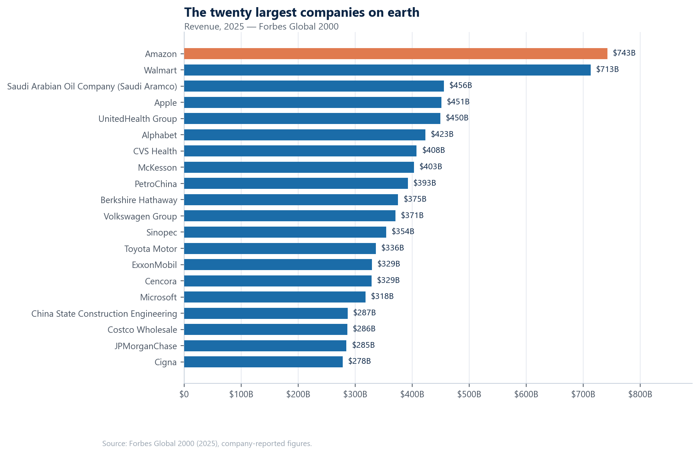
*Ranked by revenue, the top twenty account for a quarter of all corporate output measured in the Forbes Global 2000.*

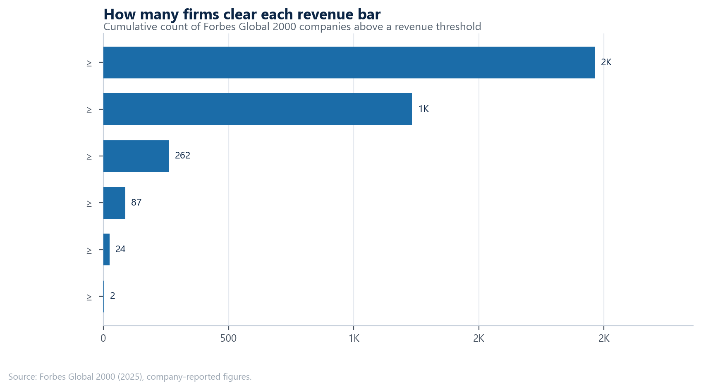
*How many firms clear each revenue bar — Cumulative count above a revenue threshold*

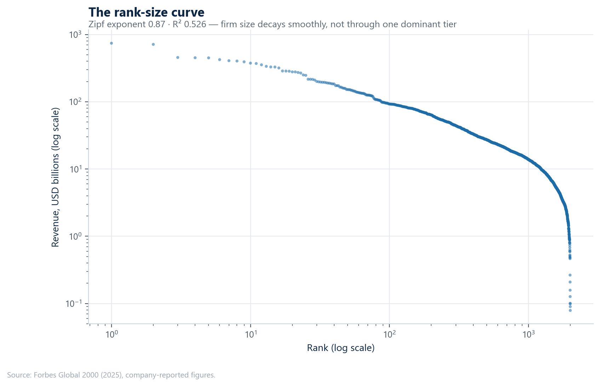
*The rank-size curve — Revenue against rank, both on a log scale*

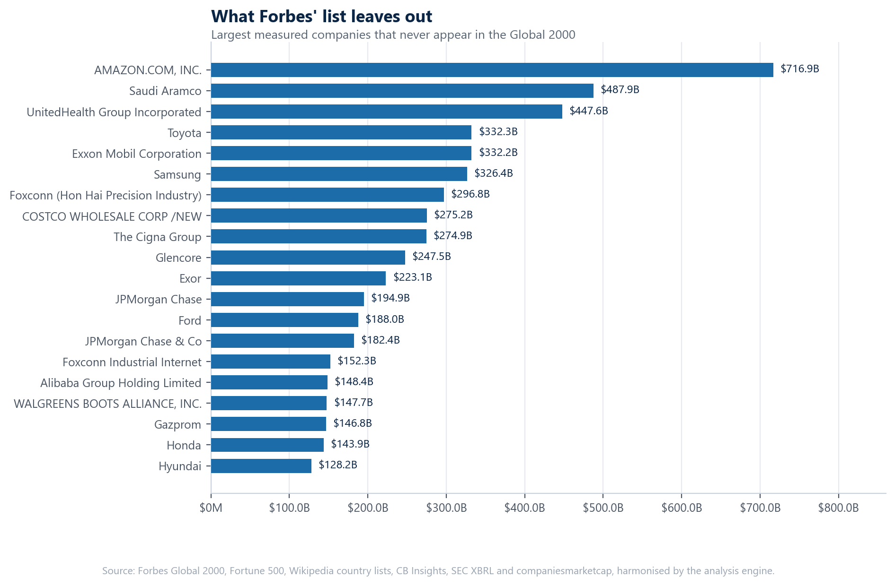
*What Forbes' list leaves out — Largest measured companies absent from the Global 2000*

### Firm counts above each revenue threshold

**Firm counts above each revenue threshold**

| threshold | firms |
|---|---|
| gt_1b | 1,967 |
| gt_10b | 1,210 |
| gt_50b | 242 |
| gt_100b | 83 |
| gt_250b | 20 |
| gt_500b | 2 |

_Full table: `data/scale__thresholds.csv`_ (6 rows, 2 columns)._

### Largest firms that are not on Forbes' Global 2000 list

**Largest firms that are not on Forbes' Global 2000 list**

| company | country | revenue_musd | sector |
|---|---|---|---|
| AMAZON.COM, INC. | United States | $1M | Unclassified |
| Saudi Aramco | Saudi Arabia | $0M | Unclassified |
| UnitedHealth Group Incorporated | United States | $0M | Unclassified |
| Toyota | Japan | $0M | Unclassified |
| Exxon Mobil Corporation | United States | $0M | Unclassified |
| Samsung | South Korea | $0M | Unclassified |
| Foxconn (Hon Hai Precision Industry) | Taiwan | $0M | Unclassified |
| COSTCO WHOLESALE CORP /NEW | United States | $0M | Unclassified |
| The Cigna Group | United States | $0M | Unclassified |
| Glencore | Switzerland | $0M | Unclassified |
| JPMorgan Chase | United States | $0M | Unclassified |
| Bullish | Cayman Islands | $0M | Unclassified |
| Ford | United States | $0M | Unclassified |
| JPMorgan Chase & Co | United States | $0M | Unclassified |
| HOME DEPOT, INC. | United States | $0M | Unclassified |

_Full table: `data/scale__top_beyond_forbes.csv`_ (25 rows, 5 columns)._
# Geography: where the money sits

How the measured corporate revenue and profit distribute across countries and regions, and how far that map deviates from a map of world GDP.

### What the data shows
- Country size tracks corporate size, but loosely. Across the 60 countries Forbes covers, the correlation between a country's share of world GDP and its share of Global-2000 revenue is **ρ = 0.87** (p = <0.001).
- Mixing in the Fortune 500, the Wikipedia country lists and the listed universe *raises* that correlation to **ρ = 0.85** (p = <0.001) -- the Forbes list alone was distorting the map, and mixing the sources repairs part of the distortion.
- National concentration is extreme. One country holds **36.9%** of the revenue in Forbes' list, the top five hold **68.0%** and the top ten **82.1%**. National HHI on revenue is **1734** points (mixed view: 1647).
- **23 countries** appear in the mixed view with no representative at all in Forbes' 2,000, together worth **$770B**. The largest such gaps are Russian Federation ($542B), Turks and Caicos Islands ($81B), New Zealand ($61B), Nigeria ($38B), Iceland ($12B).

### Charts

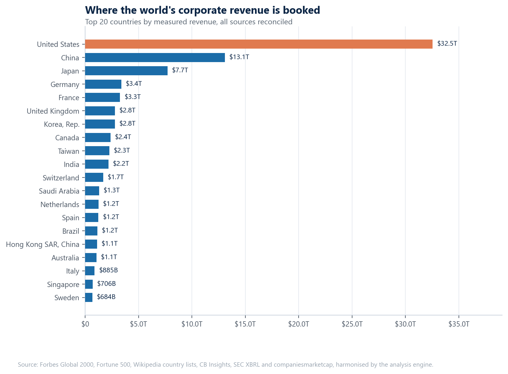
*Where the world's corporate revenue is booked — Top 20 countries by measured revenue*

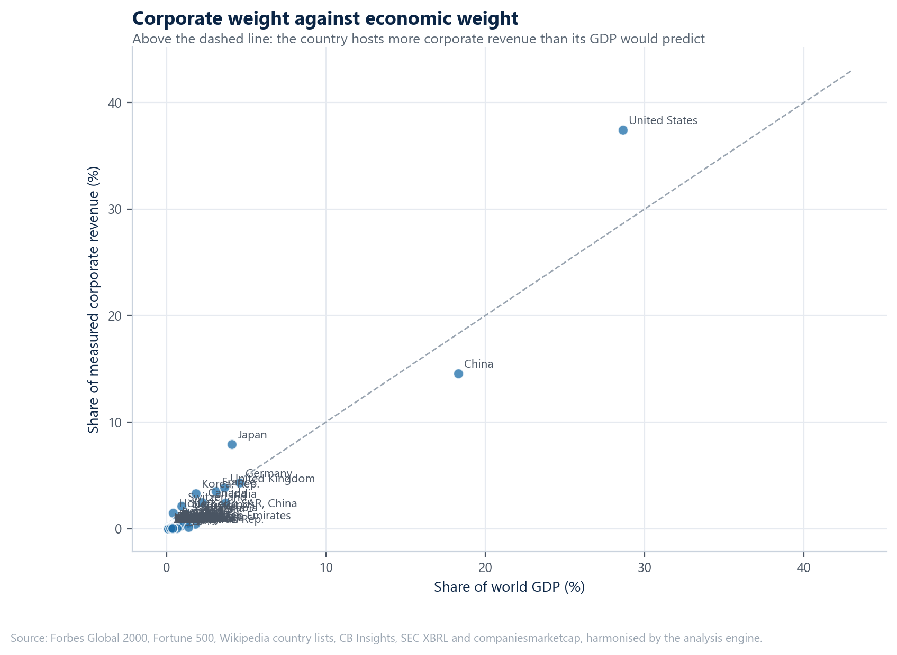
*Corporate weight against economic weight — Revenue share against GDP share*

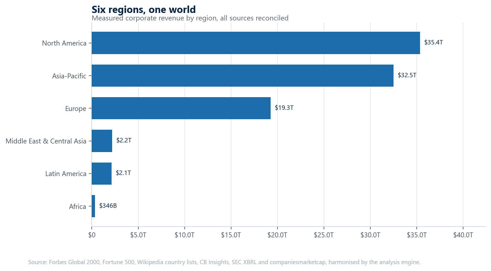
*Six regions, one world — Measured revenue by region*

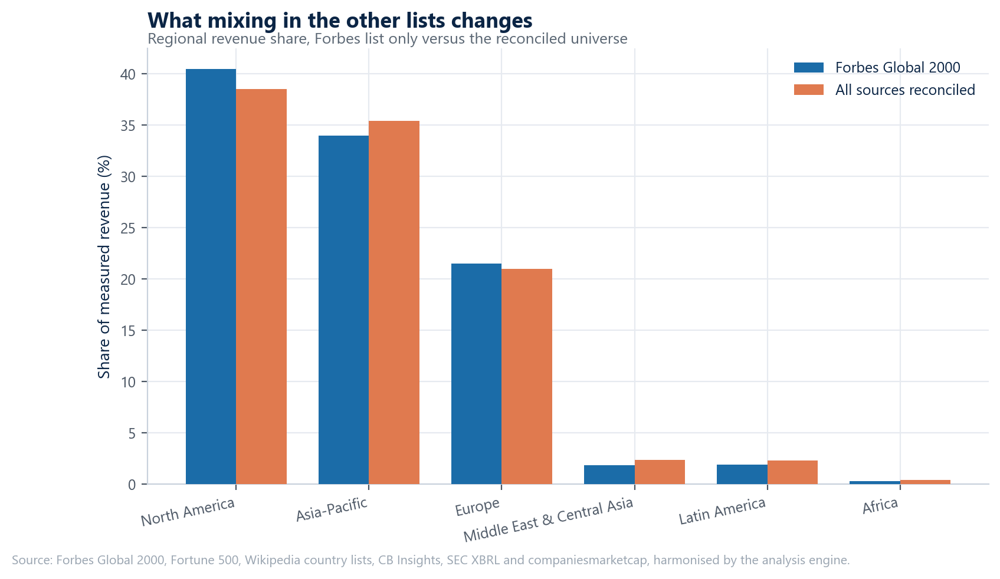
*What mixing in the other lists changes — Forbes-only versus reconciled regional shares*

### Regional rollup of the reconciled universe

**Regional rollup of the reconciled universe**

| region | countries | companies | revenue_usd | profit_usd | market_cap_usd | employees | revenue_share | profit_margin | revenue_per_employee | countries_count |
|---|---|---|---|---|---|---|---|---|---|---|
| North America | 4 | 7,186 | $35.3T | $2.4T | $96.7T | 37,339,945 | 39.2% | 6.9% | 944,947 | 4.00 |
| Asia-Pacific | 15 | 3,731 | $31.6T | $1.8T | $38.8T | 35,619,054 | 35.1% | 5.6% | 888,499 | 15.00 |
| Europe | 35 | 2,824 | $18.6T | $1.0T | $24.3T | 24,843,553 | 20.7% | 5.6% | 749,604 | 35.00 |
| Middle East & Central Asia | 12 | 860 | $2.1T | $318B | $6.8T | 339,675 | 2.4% | 15.0% | 6,239,027 | 12.00 |
| Latin America | 12 | 249 | $2.1T | $100B | $2.2T | 2,730,027 | 2.3% | 4.8% | 769,149 | 12.00 |
| Africa | 6 | 88 | $315B | $22B | $427B | 342,689 | 0.4% | 7.1% | 920,215 | 6.00 |

_Full table: `data/geography__regions_mixed.csv`_ (6 rows, 11 columns)._

### Largest country economies of the corporate world

**Largest country economies of the corporate world**

| country | companies | revenue_usd | profit_usd | market_cap_usd | revenue_share | index_vs_gdp |
|---|---|---|---|---|---|---|
| United Arab Emirates | 135 | $254B | $47B | $1.2T | 0.3% | 0.54x |
| Argentina | 18 | $84B | $6B | $153B | 0.1% | 0.15x |
| Australia | 367 | $1.1T | $82B | $2.1T | 1.2% | 0.71x |
| Austria | 53 | $237B | $10B | $200B | 0.3% | 0.52x |
| Belgium | 84 | $286B | $17B | $402B | 0.3% | 0.50x |
| Bulgaria | 1 | $2B | $0 | $2B | 0.0% | 0.02x |
| Bahrain | 25 | $13B | $285M | $20B | 0.0% | 0.32x |
| Bahamas, The | 1 | $961M | $0 | $2B | 0.0% | 0.07x |
| Bermuda | 38 | $204B | $8B | $285B | 0.2% | 26.01x |
| Brazil | 129 | $1.2T | $68B | $1.2T | 1.3% | 0.62x |
| Canada | 462 | $2.5T | $171B | $4.8T | 2.7% | 1.27x |
| Switzerland | 221 | $1.7T | $121B | $3.0T | 1.9% | 2.06x |
| Chile | 27 | $180B | $4B | $170B | 0.2% | 0.64x |
| China | 823 | $12.8T | $736B | $11.7T | 14.2% | 0.80x |
| Colombia | 12 | $91B | $8B | $68B | 0.1% | 0.25x |
| Costa Rica | 1 | $211M | $0 | $2B | 0.0% | 0.00x |
| Cayman Islands | 12 | $215B | $1B | $109B | 0.2% | 32.53x |
| Cyprus | 4 | $7B | $550M | $5B | 0.0% | 0.22x |
| Czechia | 6 | $23B | $1B | $60B | 0.0% | 0.08x |
| Germany | 350 | $3.3T | $109B | $3.1T | 3.7% | 0.83x |

_Full table: `data/geography__country_mixed.csv`_ (84 rows, 18 columns)._

### Countries over- and under-indexed against their own GDP

**Countries over- and under-indexed against their own GDP**

| country | companies | revenue_usd | gdp_usd | revenue_share | gdp_share | index_vs_gdp |
|---|---|---|---|---|---|---|
| Hong Kong SAR, China | 42 | $886B | $408B | 1.7% | 0.004 | 4.17x |
| Luxembourg | 4 | $109B | $93B | 0.2% | 0.001 | 2.25x |
| Switzerland | 45 | $1.1T | $970B | 2.1% | 0.010 | 2.23x |
| Japan | 180 | $4.2T | $4.2T | 8.0% | 0.041 | 1.94x |
| Korea, Rep. | 62 | $1.7T | $1.9T | 3.2% | 0.018 | 1.73x |
| Ireland | 25 | $457B | $609B | 0.9% | 0.006 | 1.44x |
| United States | 612 | $19.5T | $29.3T | 36.9% | 0.288 | 1.28x |
| France | 47 | $2.0T | $3.2T | 3.8% | 0.031 | 1.23x |
| Sweden | 27 | $360B | $605B | 0.7% | 0.006 | 1.14x |
| Canada | 60 | $1.3T | $2.3T | 2.5% | 0.022 | 1.12x |
| United Kingdom | 68 | $2.1T | $3.7T | 4.0% | 0.036 | 1.11x |
| Saudi Arabia | 19 | $624B | $1.3T | 1.2% | 0.012 | 0.96x |
| Denmark | 13 | $209B | $425B | 0.4% | 0.004 | 0.95x |
| Thailand | 16 | $259B | $529B | 0.5% | 0.005 | 0.94x |
| Germany | 49 | $2.3T | $4.7T | 4.3% | 0.046 | 0.93x |
| Finland | 10 | $143B | $299B | 0.3% | 0.003 | 0.92x |
| Netherlands | 24 | $559B | $1.2T | 1.1% | 0.012 | 0.88x |
| China | 275 | $7.8T | $18.7T | 14.8% | 0.184 | 0.80x |
| Singapore | 11 | $236B | $573B | 0.4% | 0.006 | 0.79x |
| Spain | 18 | $624B | $1.7T | 1.2% | 0.017 | 0.70x |

_Full table: `data/geography__over_under.csv`_ (55 rows, 7 columns)._
# Industry: what the money does

Which sectors carry the revenue, which carry the profit, and how wide the margin distributions are inside each sector.

### What the data shows
- Profit is pooled far more unevenly than revenue. **Financials** takes 34.0% ($1661B); **Technology** takes 16.7% ($815B); **Energy & Utilities** takes 11.2% ($550B); **Consumer & Retail** takes 10.7% ($522B); **Healthcare** takes 5.3% ($258B).
- ROA is exactly margin x turnover (largest identity error 6.94e-18), and it splits the map in two. **Margin-driven** sectors: Technology, Healthcare, Industrials & Defense, Transport & Logistics. **Turnover-driven** sectors: Consumer & Retail, Food & Agriculture, Materials & Chemicals.
- Productivity per employee spans four orders of magnitude: the median firm earns **$0.6M** per head, the 99th percentile **$2M**, and the top firm **915x** the median.
- **Conglomerates** has the highest rate of loss-making firms (25% of 8 firms), while **Financials** has the highest median net margin (15.5%).
- Does being bigger make you more profitable? Controlling for sector, a 1% larger revenue base is associated with **-0.036 pp** higher net margin (p = <0.001, significant; n = 1,981).

### Charts

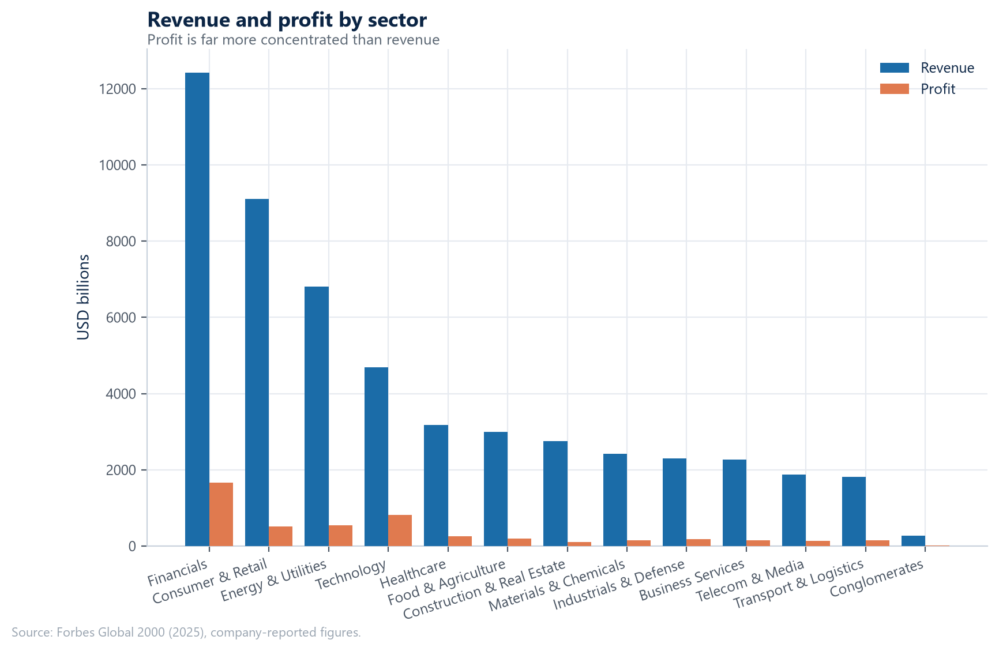
*Revenue and profit by sector — Where the money comes from, and where it stays*

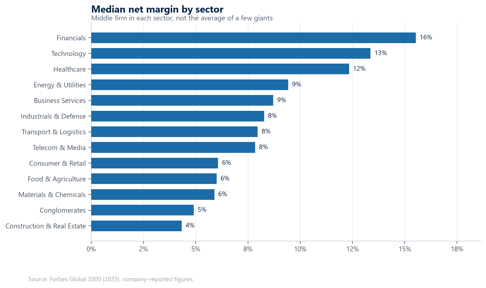
*Median net margin by sector — The middle firm in each sector*

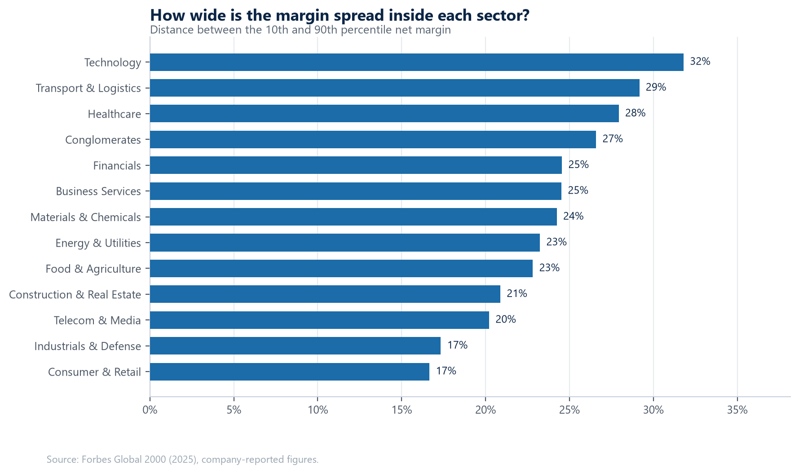
*How wide is the margin spread inside each sector? — 10th to 90th percentile net margin*

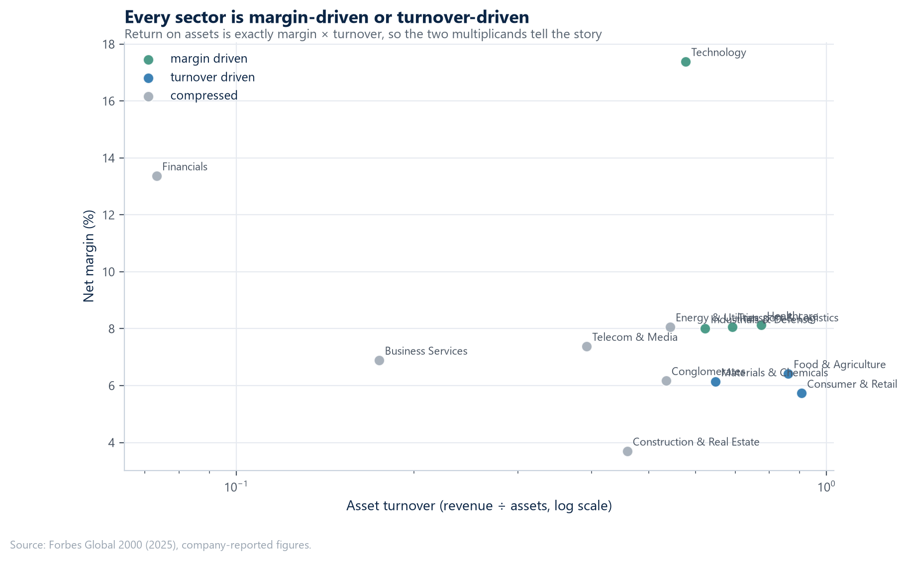
*Every sector is margin-driven or turnover-driven — Net margin against asset turnover*

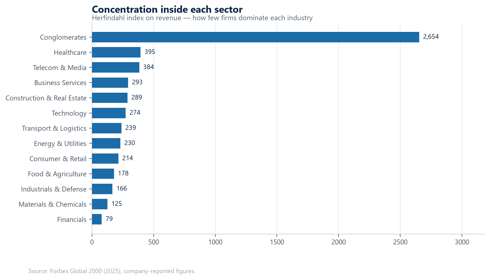
*Concentration inside each sector — Herfindahl index on revenue*

### Sector scoreboard

**Sector scoreboard**

| sector | companies | revenue_usd | profit_usd | assets_usd | market_cap_usd | employees | profit_margin | roa | asset_turnover | revenue_per_employee | profit_per_employee | market_cap_to_revenue | market_cap_to_profit | revenue_share | profit_share | roa_check |
|---|---|---|---|---|---|---|---|---|---|---|---|---|---|---|---|---|
| Financials | 578 | $12.4T | $1.7T | $169.6T | $18.8T | 14,973,295 | 13.4% | 0.010 | 0.073 | 829,866 | 110,959 | 1.51x | 11.32x | 23.5% | 34.0% | 0.010 |
| Consumer & Retail | 217 | $9.1T | $522B | $10.0T | $11.9T | 23,633,502 | 5.7% | 0.052 | 0.907 | 385,268 | 22,079 | 1.31x | 22.79x | 17.2% | 10.7% | 0.052 |
| Energy & Utilities | 188 | $6.8T | $550B | $12.5T | $7.9T | 4,568,861 | 8.1% | 0.044 | 0.543 | 1,491,365 | 120,292 | 1.16x | 14.38x | 12.9% | 11.2% | 0.044 |
| Technology | 184 | $4.7T | $815B | $8.1T | $24.5T | 9,309,972 | 17.4% | 0.100 | 0.577 | 503,660 | 87,578 | 5.22x | 30.00x | 8.9% | 16.7% | 0.100 |
| Healthcare | 105 | $3.2T | $258B | $4.1T | $7.0T | 4,757,709 | 8.1% | 0.063 | 0.775 | 668,574 | 54,310 | 2.21x | 27.23x | 6.0% | 5.3% | 0.063 |
| Food & Agriculture | 111 | $3.0T | $193B | $3.5T | $3.9T | 7,096,733 | 6.4% | 0.055 | 0.861 | 422,743 | 27,140 | 1.30x | 20.27x | 5.7% | 3.9% | 0.055 |
| Construction & Real Estate | 111 | $2.7T | $102B | $6.0T | $1.7T | 5,869,056 | 3.7% | 0.017 | 0.460 | 468,143 | 17,316 | 0.63x | 16.91x | 5.2% | 2.1% | 0.017 |
| Materials & Chemicals | 131 | $2.4T | $149B | $3.7T | $2.9T | 3,934,520 | 6.1% | 0.040 | 0.648 | 616,526 | 37,810 | 1.19x | 19.35x | 4.6% | 3.0% | 0.040 |
| Industrials & Defense | 108 | $2.3T | $184B | $3.7T | $4.8T | 5,782,994 | 8.0% | 0.050 | 0.623 | 397,275 | 31,782 | 2.11x | 26.34x | 4.3% | 3.8% | 0.050 |
| Business Services | 110 | $2.3T | $156B | $13.0T | $2.8T | 3,671,649 | 6.9% | 0.012 | 0.175 | 617,366 | 42,561 | 1.23x | 17.91x | 4.3% | 3.2% | 0.012 |
| Telecom & Media | 63 | $1.9T | $138B | $4.8T | $2.7T | 4,173,903 | 7.4% | 0.029 | 0.392 | 448,351 | 33,091 | 1.46x | 19.80x | 3.5% | 2.8% | 0.029 |
| Transport & Logistics | 84 | $1.8T | $146B | $2.6T | $1.9T | 4,601,184 | 8.1% | 0.056 | 0.693 | 393,900 | 31,761 | 1.03x | 12.83x | 3.4% | 3.0% | 0.056 |
| Conglomerates | 8 | $268B | $17B | $502B | $429B | 248,668 | 6.2% | 0.033 | 0.535 | 1,079,753 | 66,689 | 1.60x | 25.86x | 0.5% | 0.3% | 0.033 |

_Full table: `data/industry__sectors.csv`_ (13 rows, 17 columns)._

### Spread of net margins inside each sector

**Spread of net margins inside each sector**

| sector | firms | mean | median | p10 | p90 | std | iqr | cv | loss_makers | loss_rate |
|---|---|---|---|---|---|---|---|---|---|---|
| Business Services | 110 | 10.82 | 8.71 | 0.503 | 25.03 | 11.58 | 24.53 | 1.07 | 6.00 | 5.5% |
| Conglomerates | 8 | 10.80 | 4.91 | -1.40 | 25.18 | 14.80 | 26.59 | 1.37 | 2.00 | 25.0% |
| Construction & Real Estate | 109 | 6.22 | 4.33 | -0.513 | 20.37 | 15.65 | 20.88 | 2.52 | 13.00 | 11.9% |
| Consumer & Retail | 217 | 7.53 | 6.07 | 0.607 | 17.27 | 7.84 | 16.66 | 1.04 | 12.00 | 5.5% |
| Energy & Utilities | 186 | 11.37 | 9.43 | 1.09 | 24.33 | 10.31 | 23.24 | 0.907 | 12.00 | 6.5% |
| Financials | 569 | 16.63 | 15.53 | 4.43 | 28.99 | 12.11 | 24.56 | 0.728 | 11.00 | 1.9% |
| Food & Agriculture | 110 | 9.77 | 6.00 | 1.04 | 23.86 | 12.03 | 22.82 | 1.23 | 5.00 | 4.5% |
| Healthcare | 104 | 13.21 | 12.34 | 0.158 | 28.10 | 12.63 | 27.94 | 0.956 | 10.00 | 9.6% |
| Industrials & Defense | 108 | 10.05 | 8.27 | 1.92 | 19.26 | 7.35 | 17.34 | 0.731 | 4.00 | 3.7% |
| Materials & Chemicals | 131 | 8.14 | 5.90 | -1.88 | 22.37 | 11.93 | 24.25 | 1.47 | 19.00 | 14.5% |
| Technology | 183 | 13.78 | 13.36 | 0.572 | 32.37 | 17.62 | 31.80 | 1.28 | 16.00 | 8.7% |
| Telecom & Media | 62 | 7.81 | 7.84 | -2.78 | 17.44 | 14.77 | 20.22 | 1.89 | 14.00 | 22.6% |
| Transport & Logistics | 84 | 13.60 | 7.97 | 0.887 | 30.06 | 12.99 | 29.17 | 0.955 | 2.00 | 2.4% |

_Full table: `data/industry__margin_dispersion.csv`_ (13 rows, 11 columns)._

### How concentrated each sector is

**How concentrated each sector is**

| sector | firms | hhi | top5_share | gini |
|---|---|---|---|---|
| Conglomerates | 8 | 2,654 | 0.881 | 0.467 |
| Healthcare | 105 | 394.52 | 0.384 | 0.639 |
| Telecom & Media | 63 | 384.06 | 0.348 | 0.550 |
| Business Services | 110 | 292.76 | 0.304 | 0.548 |
| Construction & Real Estate | 111 | 288.56 | 0.292 | 0.529 |
| Technology | 184 | 273.72 | 0.309 | 0.651 |
| Transport & Logistics | 84 | 238.91 | 0.237 | 0.484 |
| Energy & Utilities | 188 | 230.46 | 0.276 | 0.628 |
| Consumer & Retail | 217 | 214.21 | 0.258 | 0.616 |
| Food & Agriculture | 111 | 178.46 | 0.179 | 0.481 |
| Industrials & Defense | 108 | 166.12 | 0.167 | 0.454 |
| Materials & Chemicals | 131 | 125.50 | 0.140 | 0.395 |
| Financials | 578 | 79.04 | 0.123 | 0.667 |

_Full table: `data/industry__sector_concentration.csv`_ (13 rows, 5 columns)._
# Ownership: who owns it

State, listed, private, mutual and subsidiary capital, and the large firms that no ranking list puts on the page.

### What the data shows
- State-owned enterprises account for **56** companies and **$4.05 T$** of revenue in the mixed universe -- **4.1%** of everything measured, and a profit share of only **2.4%**.
- **The invisible giants.** 11,030 companies with known revenue do not appear in the Forbes Global 2000, worth **$46.81 T$** between them. 186 of them exceed $50B in revenue -- including **AMAZON.COM, INC.** ($717B, public), **State Grid** ($555B, state), **UnitedHealth Group Incorporated** ($448B, public), **Saudi Aramco** ($446B, public).
- Re-ranking the top 100 on earth from the mixed universe, **60 of Forbes' own top 100 are displaced**, and the true top 100 is worth **$23.95 T$** against Forbes' $15.48 T$ (a $8475B gap).
- **state vs listed**: median net margin 2.0% vs 9.8% (means 3.1% vs 12.0%; difference in means -8.9 pp, bootstrap CI [-10.3, -7.5] pp, p = <0.001).
- **state vs private/PE**: median net margin 2.0% vs 1.0% (means 3.1% vs 2.3%; difference in means +0.8 pp, bootstrap CI [-0.9, +2.6] pp, p = 0.360).
- **mutual vs listed**: median net margin 3.7% vs 9.8% (means 5.3% vs 12.0%; difference in means -6.7 pp, bootstrap CI [-9.2, -3.9] pp, p = <0.001).
- 42 rows were dropped from the margin comparison because a net margin outside [-100%, +100%] is arithmetically impossible for a standalone operating business.

### Charts

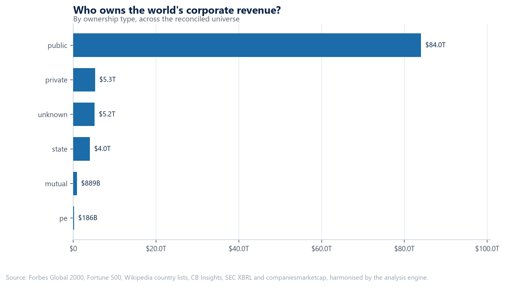
*Who owns the world's corporate revenue? — Revenue by ownership type*

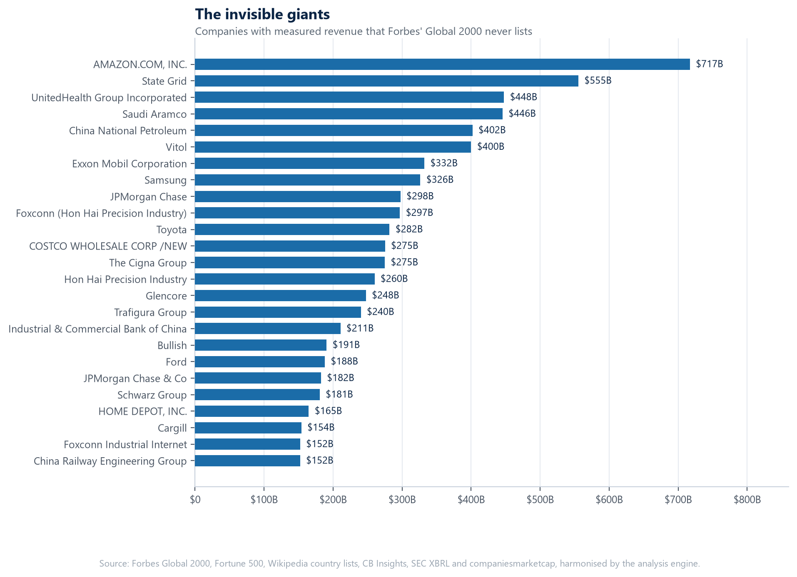
*The invisible giants — Measured companies missing from the Global 2000*

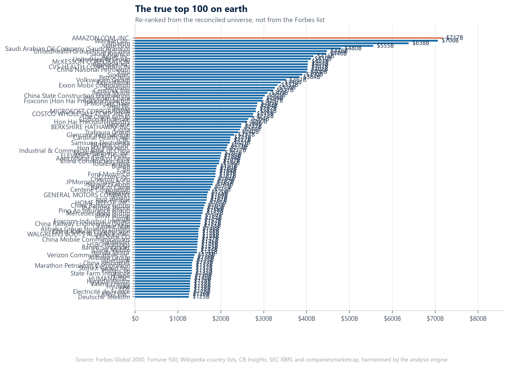
*The true top 100 on earth — Re-ranked from the reconciled universe*

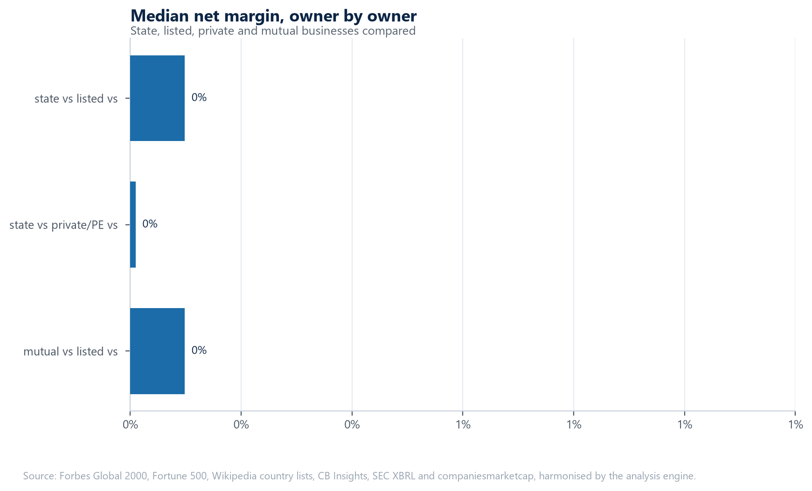
*Median net margin, owner by owner — State, listed, private and mutual businesses*

### Ownership split of the reconciled universe

**Ownership split of the reconciled universe**

| ownership | companies | revenue_usd | profit_usd | market_cap_usd | employees | profit_margin | revenue_per_employee | revenue_share | profit_share |
|---|---|---|---|---|---|---|---|---|---|
| state | 56 | $4.0T | $146B | $268B | 779,034 | 3.6% | 5,192,824 | 4.1% | 2.4% |
| mutual | 15 | $889B | $49B | $0 | 77,283 | 5.5% | 11,496,728 | 0.9% | 0.8% |
| pe | 1,442 | $186B | $1B | $59B | 187,379 | 0.6% | 992,646 | 0.2% | 0.0% |
| public | 13,000 | $84.0T | $5.6T | $169.2T | 94,680,269 | 6.7% | 887,488 | 84.4% | 92.9% |
| private | 338 | $5.3T | $82B | $37B | 3,753,747 | 1.6% | 1,407,979 | 5.3% | 1.4% |
| unknown | 324 | $5.2T | $148B | $1.3T | 2,005,226 | 2.9% | 2,580,596 | 5.2% | 2.5% |

_Full table: `data/ownership__ownership_mixed.csv`_ (6 rows, 10 columns)._

### The true top 100 once every source is reconciled

**The true top 100 once every source is reconciled**

| company | country | ownership | sector | revenue_usd | forbes_rank |
|---|---|---|---|---|---|
| AMAZON.COM, INC. | United States | public | Unclassified | $717B | — |
| Walmart Inc. | United States | public | Unclassified | $706B | 18 |
| Amazon | United States | public | Consumer & Retail | $638B | 5 |
| State Grid | — | state | Unclassified | $555B | — |
| Saudi Arabian Oil Company (Saudi Aramco) | Saudi Arabia | public | Energy & Utilities | $480B | 4 |
| UnitedHealth Group Incorporated | United States | public | Unclassified | $448B | — |
| Saudi Aramco | Saudi Arabia | public | Unclassified | $446B | — |
| Apple Inc. | United States | public | Unclassified | $416B | 11 |
| UnitedHealth Group | United States | public | Financials | $410B | 17 |
| McKESSON CORPORATION | United States | public | Unclassified | $403B | 195 |
| Alphabet Inc. | United States | public | Unclassified | $403B | 9 |
| CVS HEALTH CORPORATION | United States | public | Unclassified | $402B | 74 |
| China National Petroleum | — | state | Unclassified | $402B | — |
| Vitol | World (private) | unknown | Unclassified | $400B | — |
| Sinopec | China | public | Energy & Utilities | $390B | 51 |
| PetroChina | China | public | Energy & Utilities | $384B | 28 |
| Volkswagen Group | Germany | public | Consumer & Retail | $351B | 54 |
| ExxonMobil | United States | public | Energy & Utilities | $340B | 13 |
| Exxon Mobil Corporation | United States | public | Unclassified | $332B | — |
| Samsung | South Korea | public | Unclassified | $326B | — |
| Cencora, Inc. | United States | public | Unclassified | $321B | 287 |
| Toyota Motor | Japan | public | Consumer & Retail | $309B | 14 |
| China State Construction Engineering | China | public | Construction & Real Estate | $303B | 136 |
| JPMorgan Chase | United States | public | Unclassified | $298B | — |
| Foxconn (Hon Hai Precision Industry) | Taiwan | public | Unclassified | $297B | — |

_Full table: `data/ownership__true_top100.csv`_ (100 rows, 50 columns)._

### The invisible giants, by country

**The invisible giants, by country**

| country | firms | revenue_usd |
|---|---|---|
| United States | 4,876 | $12.9T |
| China | 366 | $4.7T |
| World (private) | 78 | $3.5T |
| Japan | 765 | $3.3T |
| Europe | 35 | $2.8T |
| Taiwan | 89 | $1.2T |
| Canada | 329 | $1.1T |
| South Korea | 130 | $989B |
| Germany | 256 | $976B |
| France | 238 | $955B |
| India | 508 | $866B |
| Saudi Arabia | 214 | $695B |
| United Kingdom | 376 | $618B |
| Brazil | 81 | $519B |
| Australia | 302 | $493B |

_Full table: `data/ownership__invisible_by_country.csv`_ (82 rows, 3 columns)._
# Capital: what the markets think it is worth

The listed universe: market value, sector multiples, the gap between where profit sits and where valuation sits, and how deep each national equity market is against its GDP.

### What the data shows
- The listed universe we can measure holds **10,076** companies worth **$150.5 T$**. That is extraordinarily concentrated: the top 10 hold **20.2%**, the top 100 **42.9%**, and it takes only **169** companies to reach half the total. HHI **59**, Gini **0.86**.
- The median listed company is worth **$1830.5M** while the average is **$14935.3M** -- a **8x** gap. The top 1,000 firms (9.9% of the universe) alone hold **78.5%** of all measured market value.
- Financial depth varies by an order of magnitude. Among economies large enough to host a real equity market (economy with GDP >= $100B and >= 5 listed companies), the deepest market is **3.17x** GDP (Switzerland) and the shallowest **0.12x** (Pakistan). (26 micro-states (Bahamas, Bahrain, Bermuda, Bulgaria, Cambodia, Cayman Islands...) are excluded: they host a handful of multinational registrations, not a genuine domestic market.)
- Market value scales with revenue with an elasticity of **0.63** (95% CI [0.62, 0.64], p = <0.001; n = 9,609). Because the elasticity is below 1, doubling revenue multiplies market value by about **1.54x**, not 2x -- scale by itself does not earn a higher valuation multiple, because the price-to-sales multiple shrinks as revenue grows.
- Profit and market value disagree about which businesses matter. **Financials** earns 34.1% of profit but is only 20.6% of market value; **Energy & Utilities** earns 11.3% of profit but is only 8.7% of market value. Conversely **Technology** (-10.1 pp); **Consumer & Retail** (-2.8 pp); **Healthcare** (-2.4 pp).

### Charts

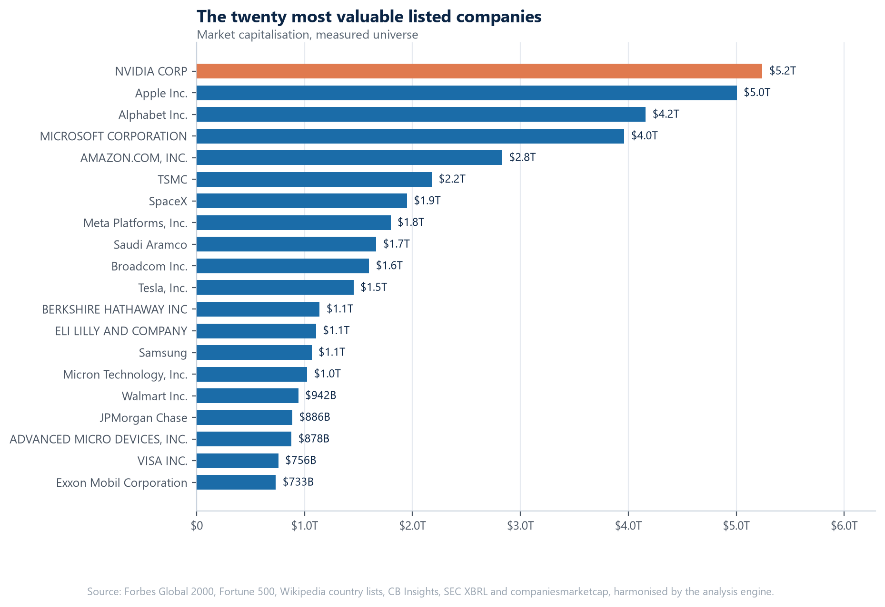
*The twenty most valuable listed companies — Market capitalisation*

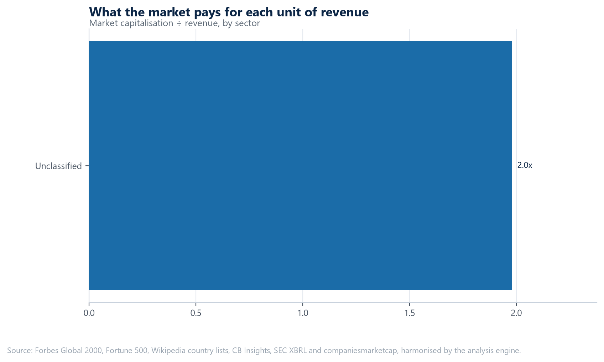
*What the market pays for each unit of revenue — Market capitalisation ÷ revenue, by sector*

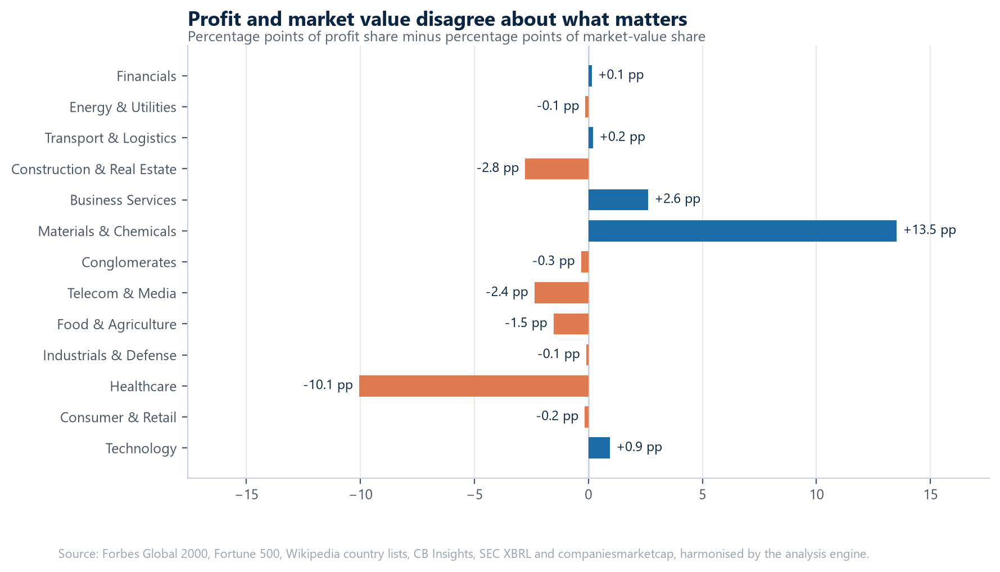
*Profit and market value disagree about what matters — Profit share minus market-value share, by sector*

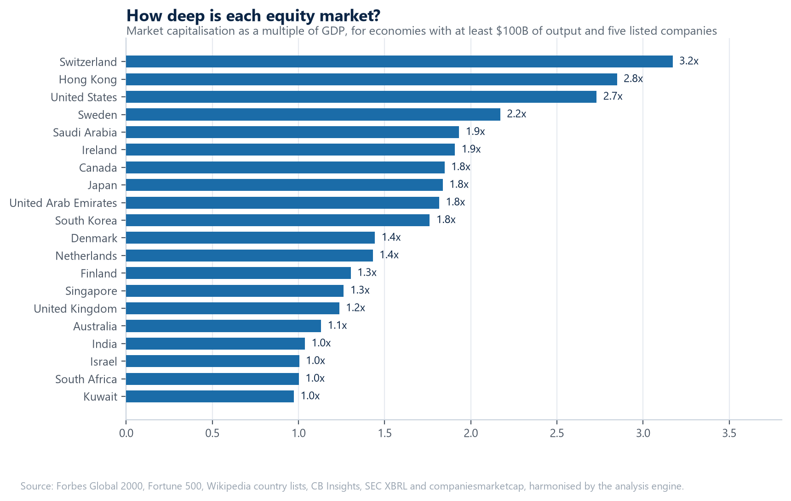
*How deep is each equity market? — Market capitalisation as a multiple of GDP*

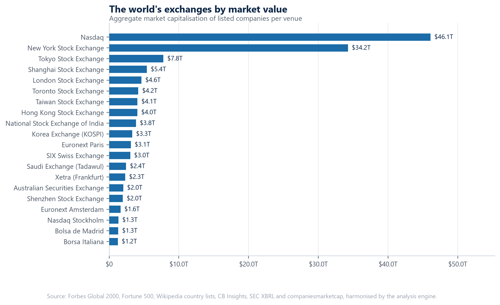
*The world's exchanges by market value — Aggregate market capitalisation per venue*

### Profit share against market-value share, by sector

**Profit share against market-value share, by sector**

| sector | revenue | profit | market_cap | profit_share | market_cap_share | profit_minus_mcap_pp | market_cap_to_profit |
|---|---|---|---|---|---|---|---|
| Business Services | $2.3T | $156B | $2.8T | 3.2% | 3.1% | 0.143 | 17.91x |
| Conglomerates | $268B | $17B | $429B | 0.3% | 0.5% | -0.129 | 25.86x |
| Construction & Real Estate | $2.7T | $102B | $1.7T | 2.1% | 1.9% | 0.204 | 16.91x |
| Consumer & Retail | $9.1T | $500B | $11.9T | 10.3% | 13.0% | -2.77 | 23.80x |
| Energy & Utilities | $6.8T | $550B | $7.9T | 11.3% | 8.7% | 2.62 | 14.38x |
| Financials | $12.4T | $1.7T | $18.8T | 34.1% | 20.6% | 13.52 | 11.32x |
| Food & Agriculture | $3.0T | $193B | $3.9T | 4.0% | 4.3% | -0.323 | 20.27x |
| Healthcare | $3.2T | $260B | $7.0T | 5.3% | 7.7% | -2.37 | 27.06x |
| Industrials & Defense | $2.3T | $184B | $4.8T | 3.8% | 5.3% | -1.53 | 26.34x |
| Materials & Chemicals | $2.4T | $149B | $2.9T | 3.1% | 3.2% | -0.099 | 19.35x |
| Technology | $4.7T | $815B | $24.5T | 16.7% | 26.8% | -10.05 | 30.00x |
| Telecom & Media | $1.9T | $138B | $2.7T | 2.8% | 3.0% | -0.161 | 19.80x |
| Transport & Logistics | $1.8T | $146B | $1.9T | 3.0% | 2.1% | 0.946 | 12.83x |

_Full table: `data/capital__profit_pool.csv`_ (13 rows, 8 columns)._

### Equity-market depth against GDP

**Equity-market depth against GDP**

| country | market_cap | companies | iso3 | gdp | mcap_to_gdp |
|---|---|---|---|---|---|
| Argentina | $149B | 16 | ARG | 638,365,455,340 | 0.23x |
| Australia | $2.0T | 348 | AUS | 1,757,022,451,653 | 1.13x |
| Austria | $249B | 50 | AUT | 534,790,720,467 | 0.47x |
| Bahamas | $2B | 1 | BHS | 15,832,800,000 | 0.15x |
| Bahrain | $19B | 24 | BHR | 47,210,732,713 | 0.40x |
| Belgium | $461B | 75 | BEL | 670,983,130,619 | 0.69x |
| Bermuda | $285B | 37 | BMU | 9,194,499,000 | 31.02x |
| Brazil | $1.1T | 91 | BRA | 2,185,821,610,689 | 0.52x |
| Bulgaria | $2B | 1 | BGR | 113,349,149,167 | 0.02x |
| Cambodia | $6B | 6 | KHM | 46,352,647,037 | 0.12x |
| Canada | $4.2T | 412 | CAN | 2,270,076,189,683 | 1.85x |
| Cayman Islands | $23B | 9 | CYM | 7,765,336,505 | 3.00x |
| Chile | $169B | 24 | CHL | 329,260,633,699 | 0.51x |
| China | $10.9T | 452 | CHN | 18,729,668,435,848 | 0.58x |
| Colombia | $66B | 4 | COL | 420,504,033,143 | 0.16x |
| Costa Rica | $2B | 1 | CRI | 96,715,644,331 | 0.02x |
| Cyprus | $3B | 3 | CYP | 37,634,551,821 | 0.07x |
| Czech Republic | $67B | 5 | CZE | 347,082,562,221 | 0.19x |
| Denmark | $613B | 58 | DNK | 424,524,722,037 | 1.44x |
| Egypt | $8B | 2 | EGY | 389,059,910,593 | 0.02x |

_Full table: `data/capital__financial_depth.csv`_ (74 rows, 6 columns)._

### Largest listed companies by market value

**Largest listed companies by market value**

| company | country | sector | market_cap_usd | revenue_usd | revenue_basis |
|---|---|---|---|---|---|
| NVIDIA CORP | United States | Unclassified | $5.2T | $216B | sec_filing |
| Apple Inc. | United States | Unclassified | $5.0T | $416B | sec_filing |
| Alphabet Inc. | United States | Unclassified | $4.2T | $403B | sec_filing |
| MICROSOFT CORPORATION | United States | Unclassified | $4.0T | $282B | sec_filing |
| AMAZON.COM, INC. | United States | Unclassified | $2.8T | $717B | sec_filing |
| TSMC | Taiwan | Unclassified | $2.2T | $122B | estimate |
| SpaceX | United States | Unclassified | $1.9T | $21B | estimate |
| Meta Platforms, Inc. | United States | Unclassified | $1.8T | $201B | sec_filing |
| Saudi Aramco | Saudi Arabia | Unclassified | $1.7T | $488B | estimate |
| Broadcom Inc. | United States | Unclassified | $1.6T | $64B | sec_filing |
| Tesla, Inc. | United States | Unclassified | $1.5T | $95B | sec_filing |
| BERKSHIRE HATHAWAY INC | United States | Unclassified | $1.1T | $247B | sec_filing |
| ELI LILLY AND COMPANY | United States | Unclassified | $1.1T | $65B | sec_filing |
| Samsung | South Korea | Unclassified | $1.1T | $326B | estimate |
| Micron Technology, Inc. | United States | Unclassified | $1.0T | $37B | sec_filing |
| Walmart Inc. | United States | Unclassified | $942B | $706B | sec_filing |
| JPMorgan Chase | United States | Unclassified | $886B | $195B | estimate |
| ADVANCED MICRO DEVICES, INC. | United States | Unclassified | $878B | $35B | sec_filing |
| VISA INC. | United States | Unclassified | $756B | $40B | sec_filing |
| Exxon Mobil Corporation | United States | Unclassified | $733B | $332B | sec_filing |

_Full table: `data/capital__top_listed.csv`_ (100 rows, 6 columns)._

### Exchanges by total market capitalisation

**Exchanges by total market capitalisation**

| exchange | exchange_country | city | companies | total_market_cap_usd | top10_market_cap_usd | top_company | top_company_mcap | top10_share | avg_company_cap | share_of_listed_total |
|---|---|---|---|---|---|---|---|---|---|---|
| Nasdaq | United States | New York | 1,618 | 46,088,902,094,592 | 29,020,750,348,288 | NVIDIA | 5,242,072,072,192 | 0.630 | 28,485,106,363 | 0.310 |
| New York Stock Exchange | United States | New York | 1,467 | 34,246,917,347,336 | 7,113,332,031,488 | Berkshire Hathaway | 1,139,349,913,600 | 0.208 | 23,344,865,267 | 0.231 |
| Tokyo Stock Exchange | Japan | Tokyo | 903 | 7,783,181,610,177 | 1,737,222,659,993 | Mitsubishi UFJ Financial | 243,799,867,392 | 0.223 | 8,619,248,738 | 0.052 |
| Shanghai Stock Exchange | China | Shanghai | 161 | 5,408,467,235,248 | 2,590,799,492,090 | China Construction Bank | 453,087,654,798 | 0.479 | 33,592,964,194 | 0.036 |
| London Stock Exchange | United Kingdom | London | 464 | 4,627,480,057,176 | 2,030,761,233,186 | HSBC | 317,922,148,352 | 0.439 | 9,973,017,365 | 0.031 |
| Toronto Stock Exchange | Canada | Toronto | 394 | 4,179,009,403,170 | 1,419,000,881,152 | Royal Bank Of Canada | 271,763,570,688 | 0.340 | 10,606,622,851 | 0.028 |
| Taiwan Stock Exchange | Taiwan | Taipei | 95 | 4,064,892,788,273 | 3,010,547,458,829 | TSMC | 2,179,460,104,192 | 0.741 | 42,788,345,140 | 0.027 |
| Hong Kong Stock Exchange | Hong Kong | Hong Kong | 306 | 4,042,164,209,895 | 1,756,005,217,840 | ICBC | 344,722,949,059 | 0.434 | 13,209,686,960 | 0.027 |
| National Stock Exchange of India | India | Mumbai | 564 | 3,840,860,095,017 | 919,206,604,314 | Reliance Industries | 171,374,723,672 | 0.239 | 6,810,035,629 | 0.026 |
| Korea Exchange (KOSPI) | South Korea | Seoul | 159 | 3,299,137,193,755 | 2,176,987,629,173 | Samsung | 1,065,509,204,255 | 0.660 | 20,749,290,527 | 0.022 |
| Euronext Paris | France | Paris | 289 | 3,103,366,038,000 | 1,621,869,031,789 | L'Oréal | 241,027,846,057 | 0.523 | 10,738,290,789 | 0.021 |
| SIX Swiss Exchange | Switzerland | Zurich | 208 | 3,021,070,705,799 | 1,743,615,658,654 | Roche | 371,736,693,530 | 0.577 | 14,524,378,393 | 0.020 |
| Saudi Exchange (Tadawul) | Saudi Arabia | Riyadh | 229 | 2,423,015,923,980 | 2,065,452,021,314 | Saudi Aramco | 1,663,347,115,141 | 0.852 | 10,580,855,563 | 0.016 |
| Xetra (Frankfurt) | Germany | Frankfurt | 199 | 2,302,082,736,375 | 1,225,632,017,825 | SAP | 260,884,791,296 | 0.532 | 11,568,254,957 | 0.016 |
| Australian Securities Exchange | Australia | Sydney | 353 | 2,013,010,425,078 | 938,628,334,728 | BHP Group | 211,501,711,360 | 0.466 | 5,702,579,108 | 0.014 |
| Shenzhen Stock Exchange | China | Shenzhen | 116 | 1,961,934,069,762 | 826,561,085,547 | CATL | 185,256,494,218 | 0.421 | 16,913,224,739 | 0.013 |
| Euronext Amsterdam | Netherlands | Amsterdam | 62 | 1,625,236,458,531 | 1,215,050,727,548 | ASML | 634,829,275,136 | 0.748 | 26,213,491,267 | 0.011 |
| Nasdaq Stockholm | Sweden | Stockholm | 199 | 1,324,461,064,239 | 632,997,669,138 | Investor AB | 130,090,831,167 | 0.478 | 6,655,583,237 | 0.009 |
| Bolsa de Madrid | Spain | Madrid | 100 | 1,302,846,519,578 | 965,085,397,562 | Inditex | 193,644,196,795 | 0.741 | 13,028,465,196 | 0.009 |
| Borsa Italiana | Italy | Milan | 148 | 1,242,264,872,232 | 715,719,828,181 | UniCredit | 126,128,010,373 | 0.576 | 8,393,681,569 | 0.008 |

_Full table: `data/capital__exchanges.csv`_ (60 rows, 11 columns)._
# Private capital: the part without a ticker

The private half of the economy: unicorn valuations, the largest unlisted operating companies, and the frontier-lab landscape.

### What the data shows
- The private tail is enormous and unusually concentrated: **1,442** unicorns carry **7.35 T$** of paper value across **55** countries, but the top country holds **69%** of it and the top five **90%** (HHI 4937). The median unicorn is worth **$1.7B**; the mean is **3.0x** the median.
- **662** companies with measurable revenue have no listed share at all, worth **17.52 T$** — real revenue, not paper. **private** accounts for $5285B across 236 firms; **unknown** accounts for $5175B across 324 firms; **state** accounts for $3685B across 51 firms.
- Among **173** AI model builders, **45** ship open weights, **24** are partial and **104** are closed. At the frontier specifically (27 labs) the split is {'no': 12, 'partial': 8, 'yes': 7} by country {'China': 9, 'United States': 8, 'South Korea': 4, 'Russia': 2, 'United Kingdom': 1, 'Germany': 1, 'France': 1, 'India': 1} — openness is a regional strategy, not a universal one.
- **Keep the ledgers separate.** The Forbes 2,000 report **$52.9 T$** of *revenue*; the listed universe reports **$150.5 T$** of *market value*; the unicorn board reports **$7.35 T$** of *paper marks* — equal to **4.9%** of the listed market. These three numbers measure different things and must never be summed.
- The unicorn board overlaps the public world more than its reputation suggests: **19** of 1,442 unicorn names also appear in the reconciled universe. A $1B+ private mark from an old round is not a current price.

### Charts

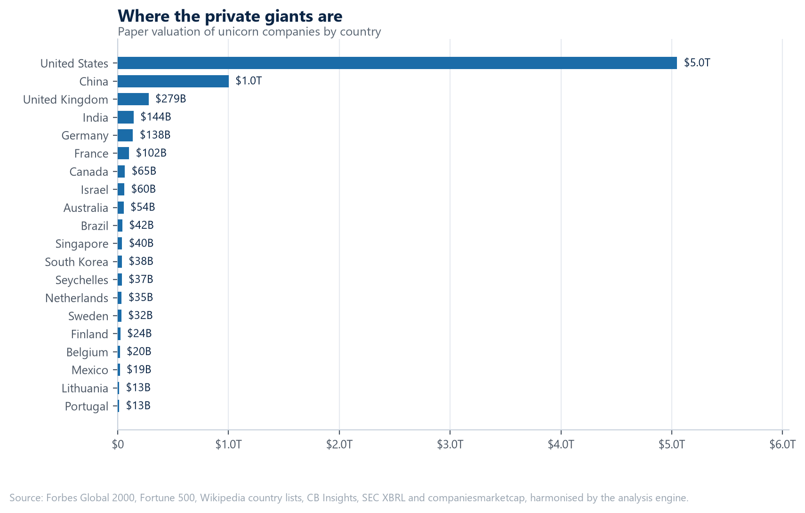
*Where the private giants are — Unicorn paper valuation by country*

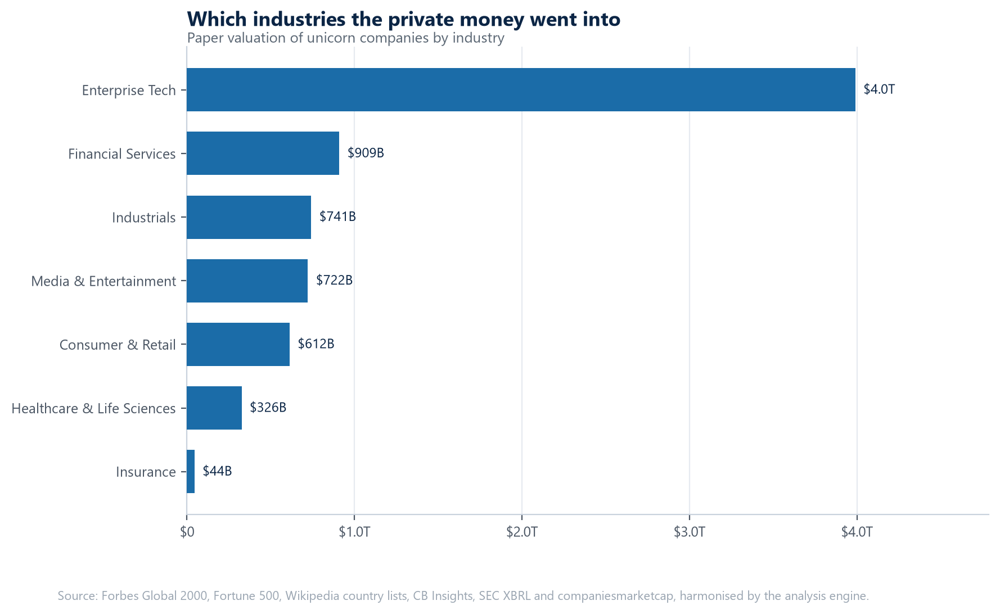
*Which industries the private money went into — Unicorn paper valuation by industry*

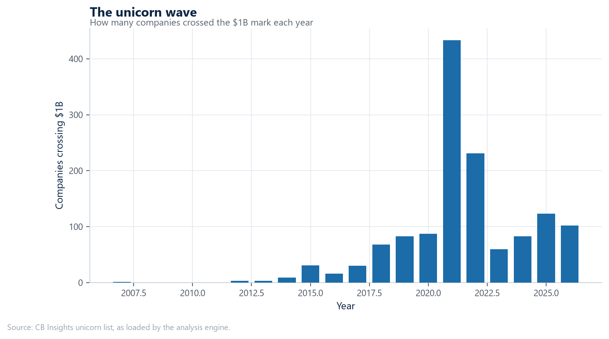
*The unicorn wave — Companies crossing $1B each year*

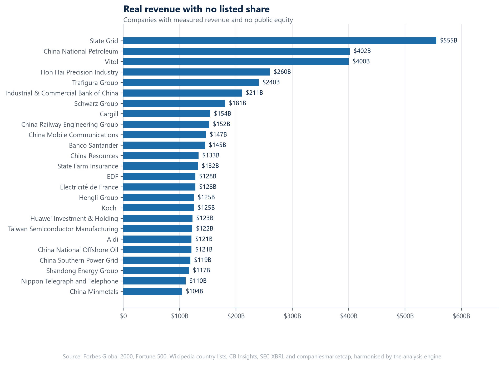
*Real revenue with no listed share — Measured revenue, no public equity*

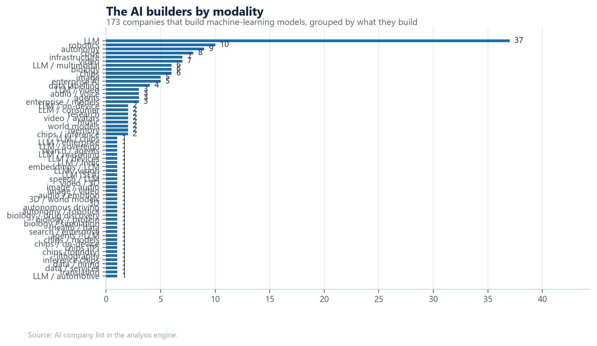
*The AI builders by modality — Model builders grouped by what they build*

### Unicorns by country

**Unicorns by country**

| country | region | companies | valuation_usd |
|---|---|---|---|
| United States | North America | 825 | $5.0T |
| China | Asia-Pacific | 170 | $1.0T |
| United Kingdom | Europe | 73 | $279B |
| India | Asia-Pacific | 63 | $144B |
| Germany | Europe | 39 | $138B |
| France | Europe | 31 | $102B |
| Canada | North America | 23 | $65B |
| Israel | Middle East & Central Asia | 26 | $60B |
| Australia | Asia-Pacific | 9 | $54B |
| Brazil | Latin America | 20 | $42B |
| Singapore | Asia-Pacific | 17 | $40B |
| South Korea | Asia-Pacific | 16 | $38B |
| Seychelles | Africa | 3 | $37B |
| Netherlands | Europe | 13 | $35B |
| Sweden | Europe | 7 | $32B |

_Full table: `data/private_capital__unicorns_by_country.csv`_ (55 rows, 4 columns)._

### Unicorns by industry

**Unicorns by industry**

| industry | companies | valuation_usd |
|---|---|---|
| Enterprise Tech | 558 | $4.0T |
| Financial Services | 227 | $909B |
| Industrials | 226 | $741B |
| Media & Entertainment | 78 | $722B |
| Consumer & Retail | 205 | $612B |
| Healthcare & Life Sciences | 126 | $326B |
| Insurance | 21 | $44B |

_Full table: `data/private_capital__unicorns_by_industry.csv`_ (7 rows, 3 columns)._

### Largest unlisted companies by revenue

**Largest unlisted companies by revenue**

| company | country | ownership | sector | revenue_usd |
|---|---|---|---|---|
| State Grid | — | state | Unclassified | $555B |
| China National Petroleum | — | state | Unclassified | $402B |
| Vitol | World (private) | unknown | Unclassified | $400B |
| Hon Hai Precision Industry | Taiwan | public | Unclassified | $260B |
| Trafigura Group | Singapore | private | Unclassified | $240B |
| Industrial & Commercial Bank of China | — | public | Unclassified | $211B |
| Schwarz Group | World (private) | unknown | Unclassified | $181B |
| Cargill | United States | private | Food & Agriculture | $154B |
| China Railway Engineering Group | — | private | Unclassified | $152B |
| China Mobile Communications | — | private | Unclassified | $147B |
| Banco Santander | Europe | public | Unclassified | $145B |
| China Resources | — | private | Unclassified | $133B |
| State Farm Insurance | United States | mutual | Unclassified | $132B |
| EDF | Europe | unknown | Energy & Utilities | $128B |
| Electricité de France | France | state | Unclassified | $128B |
| Hengli Group | China | private | Unclassified | $125B |
| Koch  | United States | private | Unclassified | $125B |
| Huawei Investment & Holding | — | private | Unclassified | $123B |
| Taiwan Semiconductor Manufacturing | Taiwan | public | Unclassified | $122B |
| Aldi | World (private) | unknown | Unclassified | $121B |

_Full table: `data/private_capital__unlisted_top.csv`_ (100 rows, 5 columns)._
# Time series: how the picture changed

The tracked cohort across years: revenue and profit paths, where the profit pool moved, and which firms climbed.

### What the data shows
- **Constant cohort: 1,287 firms, 2015–2024.** Aggregate revenue grew from $29.34T to $45.22T — ×1.54, a CAGR of 4.9% (95% CI 3.3–4.9%).
- **Profit outran revenue.** Over the same window the cohort's profit pool grew ×1.95 against revenue ×1.54 — so the blended margin widened, not narrowed.
- **The profit pool migrated.** Biggest share gainers: Oil & Gas Operations (+7.5pp), IT Software & Services (+4.0pp), Materials (+3.9pp), Semiconductors (+1.4pp), Retail and Wholesale (+1.2pp).
- **Biggest share losers:** Banking (-5.3pp), Consumer Durables (-2.9pp), Drugs & Biotechnology (-2.8pp), Telecommunications Services (-2.5pp), Food, Drink & Tobacco (-1.6pp).
- **The top of the table is sticky but not static.** Of the top 100 in 2015, 67 are still there today; of the top 500, 382 remain (76.4%).
- **Of 1,287 current Forbes firms with a full history, 15% shrank over the decade** (median growth +51.8%).

### Charts

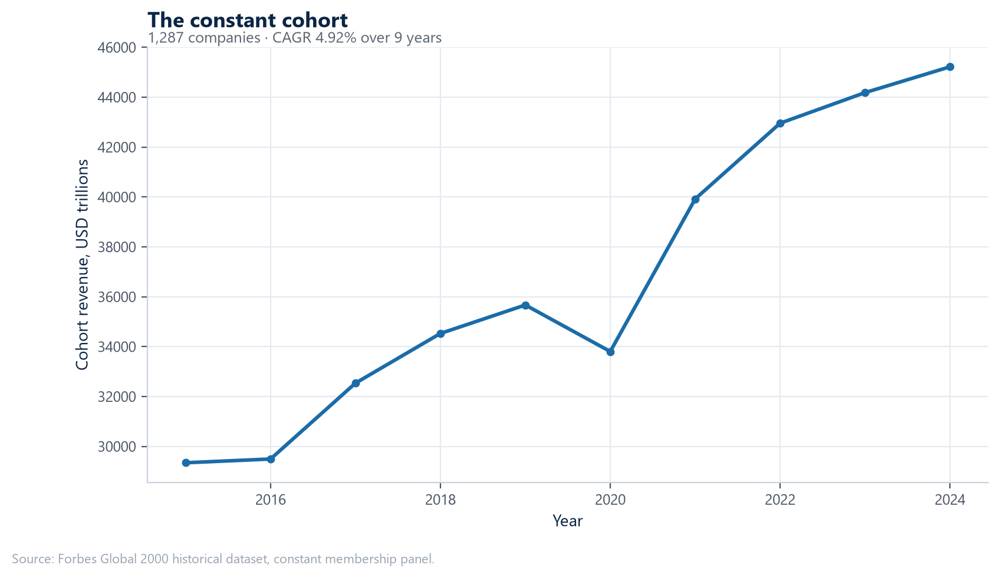
*The constant cohort — Revenue of a fixed set of companies over time*

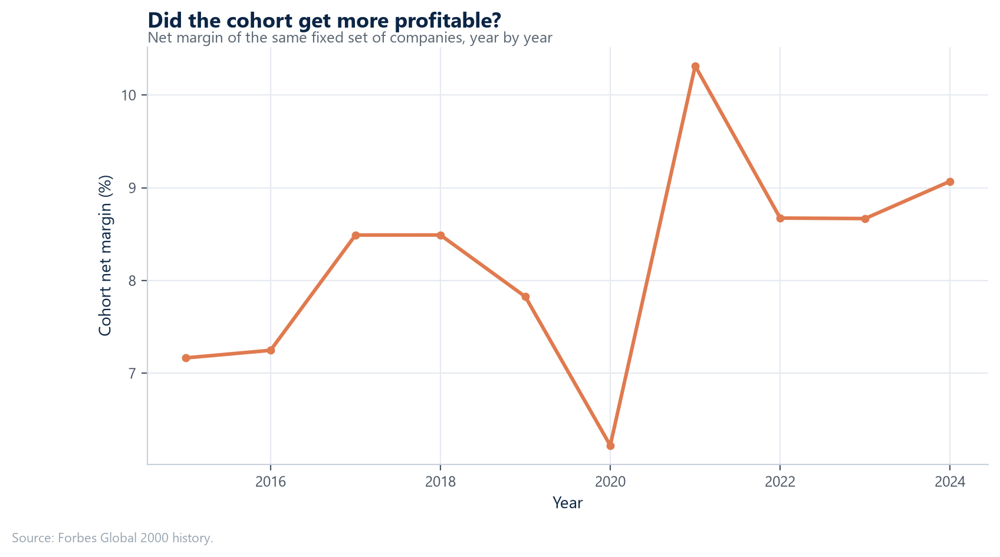
*Did the cohort get more profitable? — Net margin of a fixed cohort*

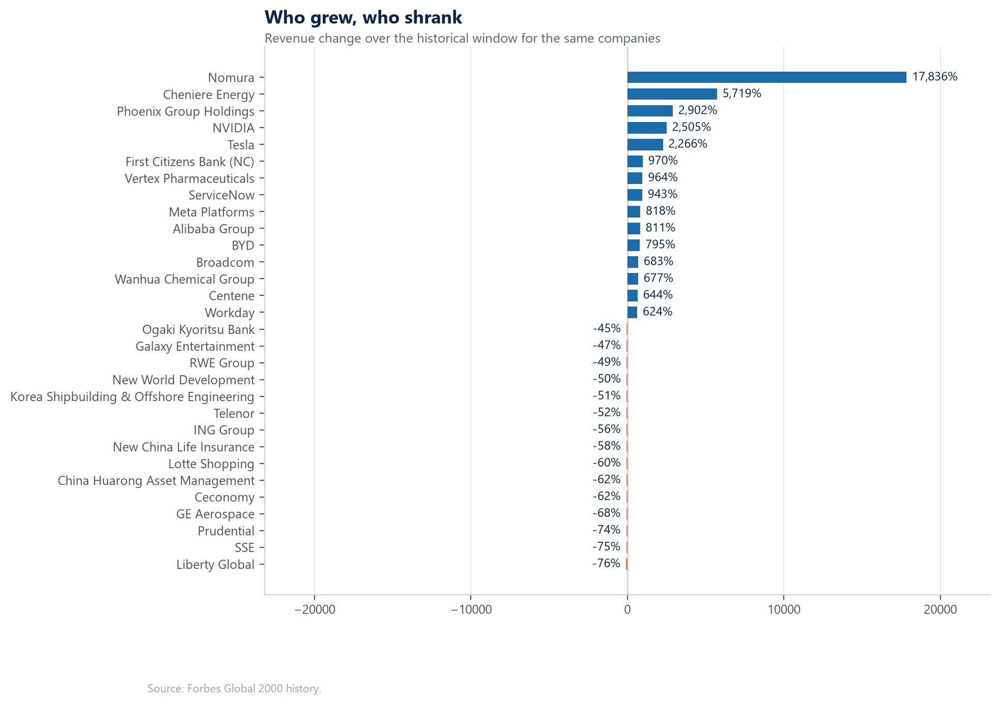
*Who grew, who shrank — Revenue change for the same companies over time*

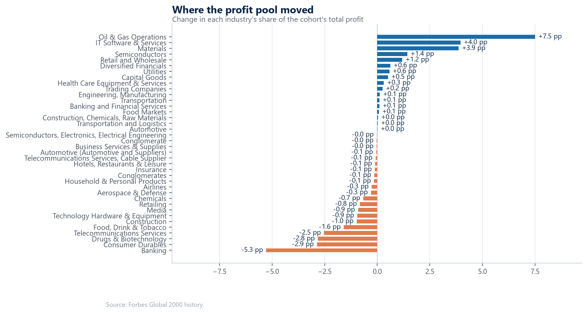
*Where the profit pool moved — Change in industry share of total profit*

### Cohort revenue, year by year

**Cohort revenue, year by year**

| year | total | n |
|---|---|---|
| 2,015 | $29M | 1,287 |
| 2,016 | $29M | 1,287 |
| 2,017 | $33M | 1,287 |
| 2,018 | $35M | 1,287 |
| 2,019 | $36M | 1,287 |
| 2,020 | $34M | 1,287 |
| 2,021 | $40M | 1,287 |
| 2,022 | $43M | 1,287 |
| 2,023 | $44M | 1,287 |
| 2,024 | $45M | 1,287 |

_Full table: `data/time_series__cohort_revenue_series.csv`_ (10 rows, 3 columns)._

### Cohort margin path

**Cohort margin path**

| year | total_rev | total_prof | margin_pct |
|---|---|---|---|
| 2,015 | $29M | $2M | 7.2% |
| 2,016 | $29M | $2M | 7.2% |
| 2,017 | $33M | $3M | 8.5% |
| 2,018 | $35M | $3M | 8.5% |
| 2,019 | $36M | $3M | 7.8% |
| 2,020 | $34M | $2M | 6.2% |
| 2,021 | $40M | $4M | 10.3% |
| 2,022 | $43M | $4M | 8.7% |
| 2,023 | $44M | $4M | 8.7% |
| 2,024 | $45M | $4M | 9.1% |

_Full table: `data/time_series__cohort_margin_path.csv`_ (10 rows, 4 columns)._

### Change in profit share by industry

**Change in profit share by industry**

| industry | revenue_start_musd | revenue_end_musd | revenue_cagr_pct | profit_start_musd | profit_end_musd | profit_cagr_pct | profit_share_end_pct | profit_share_start_pct | profit_share_change_pp |
|---|---|---|---|---|---|---|---|---|---|
| Banking | 3,213,238 | 6,368,090 | 7.9% | 556,927 | 1,033,264 | 7.1% | 21.2% | 26.5% | -5.28 |
| IT Software & Services | 746,087 | 1,981,729 | 11.5% | 108,329 | 443,928 | 17.0% | 9.1% | 5.2% | 3.96 |
| Oil & Gas Operations | 3,110,027 | 5,218,382 | 5.9% | 13,224 | 396,196 | 45.9% | 8.1% | 63.0% | 7.50 |
| Insurance | 2,711,725 | 4,321,187 | 5.3% | 167,022 | 381,597 | 9.6% | 7.8% | 7.9% | -0.110 |
| Diversified Financials | 576,796 | 1,541,770 | 11.5% | 80,067 | 215,726 | 11.6% | 4.4% | 3.8% | 0.620 |
| Technology Hardware & Equipment | 1,195,066 | 1,957,806 | 5.6% | 104,283 | 195,180 | 7.2% | 4.0% | 5.0% | -0.950 |
| Drugs & Biotechnology | 847,116 | 1,604,415 | 7.3% | 139,033 | 184,698 | 3.2% | 3.8% | 6.6% | -2.82 |
| Semiconductors | 238,239 | 733,926 | 13.3% | 45,519 | 174,685 | 16.1% | 3.6% | 2.2% | 1.43 |
| Consumer Durables | 2,513,734 | 3,766,259 | 4.6% | 135,122 | 173,429 | 2.8% | 3.6% | 6.4% | -2.87 |
| Food, Drink & Tobacco | 1,169,927 | 1,816,718 | 5.0% | 105,363 | 166,769 | 5.2% | 3.4% | 5.0% | -1.59 |
| Utilities | 1,212,155 | 1,595,457 | 3.1% | 54,104 | 153,400 | 12.3% | 3.1% | 2.6% | 0.580 |
| Retailing | 1,888,108 | 3,592,417 | 7.4% | 82,229 | 150,557 | 7.0% | 3.1% | 3.9% | -0.820 |
| Transportation | 772,981 | 1,731,991 | 9.4% | 57,838 | 139,028 | 10.2% | 2.9% | 2.8% | 0.100 |
| Business Services & Supplies | 567,432 | 1,182,140 | 8.5% | 57,096 | 130,869 | 9.7% | 2.7% | 2.7% | -0.030 |
| Capital Goods | 814,492 | 1,459,165 | 6.7% | 45,379 | 129,984 | 12.4% | 2.7% | 2.2% | 0.510 |
| Telecommunications Services | 1,293,398 | 1,345,338 | 44.0% | 105,901 | 122,033 | 1.6% | 2.5% | 5.0% | -2.53 |
| Materials | 840,429 | 1,614,392 | 7.5% | -33,064 | 112,186 | — | 2.3% | -1.6% | 3.87 |
| Construction | 1,245,908 | 2,698,471 | 9.0% | 60,924 | 93,362 | 4.9% | 1.9% | 2.9% | -0.980 |
| Household & Personal Products | 358,891 | 652,411 | 6.9% | 36,275 | 77,022 | 8.7% | 1.6% | 1.7% | -0.150 |
| Health Care Equipment & Services | 851,683 | 1,576,466 | 7.1% | 26,127 | 75,380 | 12.5% | 1.6% | 124.0% | 0.310 |

_Full table: `data/time_series__profit_pool_migration.csv`_ (38 rows, 10 columns)._

### Fastest risers among the ranked firms

**Fastest risers among the ranked firms**

| company | rank_now | growth_pct |
|---|---|---|
| Nomura | 359 | 17,836.3% |
| Cheniere Energy | 415 | 5,719.3% |
| Phoenix Group Holdings | 896 | 2,902.0% |
| NVIDIA | 47 | 2,504.7% |
| Tesla | 69 | 2,265.9% |
| First Citizens Bank (NC) | 406 | 970.3% |
| Vertex Pharmaceuticals | 960 | 964.0% |
| ServiceNow | 645 | 943.2% |
| Meta Platforms | 20 | 817.6% |
| Alibaba Group | 33 | 811.5% |
| BYD | 87 | 795.2% |
| Broadcom | 68 | 683.5% |
| Wanhua Chemical Group | 519 | 677.2% |
| Centene | 246 | 643.8% |
| Workday | 1,074 | 624.1% |
| Wuchan Zhongda Group | 1,099 | 603.2% |
| Geely Automobile Holdings | 528 | 596.3% |
| St. James's Place | 851 | 595.3% |
| Cigna | 120 | 543.3% |
| Warner Bros. Discovery | 671 | 516.1% |

_Full table: `data/time_series__mobility_forbes.csv`_ (1,287 rows, 3 columns)._
# Data quality: how far to trust the above

Where fields are empty, where two sources disagree, how old each dataset is, and the caveats that apply to every number in this pack.

### What the data shows
- **Forbes vs SEC filings.** Across 1,453 companies in both, revenue differs by a median of 10.1%; 50% agree to within 10% and 9% differ by more than 2×.
- **Forbes vs Wikipedia country lists.** Across 549 shared companies the median revenue gap is 7.1% and 77% land within 25% — the Wikipedia top-up is usable, but it is a third-tier source and is labelled as such.
- **Completeness is uneven.** Densest gaps: wiki_countries (46% of cells empty, worst column `ownership`), ai_companies (39% of cells empty, worst column `total_funding_usd`), ai_labs (34% of cells empty, worst column `parent`).
- **Every company carries a confidence score** (median 0.60, 10th percentile 0.40), derived from source trust, how many independent lists corroborate the company, and field completeness.
- **The Wikipedia top-up mostly finds companies Forbes missed.** 527 of its 1,076 companies are absent from the Forbes 2,000 — which is precisely the coverage gap the reconciled ranking is built to close.
- **Read the caveats panel before quoting any single number.** Revenue is a flow, not value added; valuations are marks, not prices; and the vintage of every series differs.

### Charts

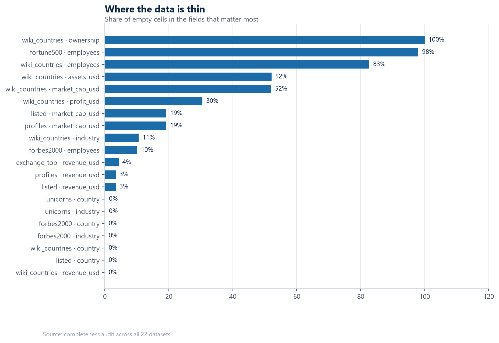
*Where the data is thin — Share of empty cells in key fields*

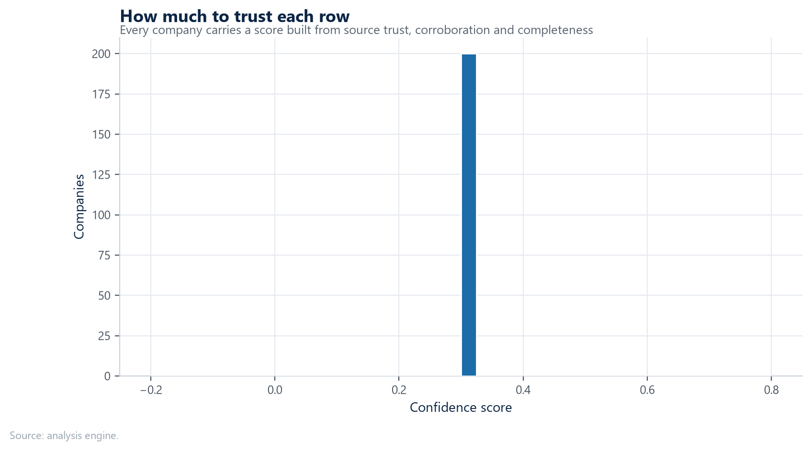
*How much to trust each row — Distribution of the confidence score*

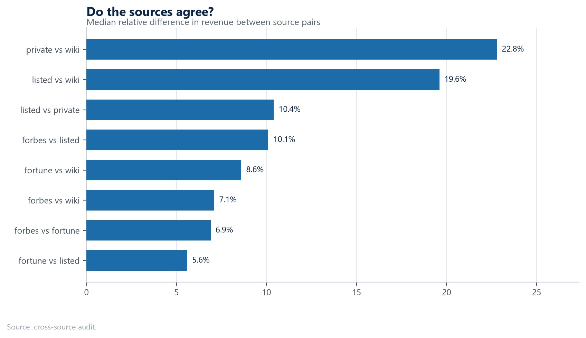
*Do the sources agree? — Median revenue disagreement between source pairs*

### Where the data actually is missing

**Where the data actually is missing**

| dataset | column | rows | missing | missing_pct | distinct |
|---|---|---|---|---|---|
| wiki_countries | ownership | 1,205 | 1,205 | 100.0% | 0.000 |
| fortune500 | employees | 500 | 490.00 | 98.0% | 10.00 |
| wiki_countries | employees | 1,205 | 996.00 | 82.7% | 208.00 |
| wiki_countries | assets_usd | 1,205 | 628.00 | 52.1% | 503.00 |
| wiki_countries | market_cap_usd | 1,205 | 627.00 | 52.0% | 428.00 |
| wiki_countries | profit_usd | 1,205 | 367.00 | 30.5% | 417.00 |
| listed | market_cap_usd | 12,512 | 2,398 | 19.2% | 10,099 |
| profiles | market_cap_usd | 12,512 | 2,398 | 19.2% | 10,099 |
| wiki_countries | industry | 1,205 | 128.00 | 10.6% | 154.00 |
| forbes2000 | employees | 2,000 | 202.00 | 10.1% | 1,612 |
| exchange_top | revenue_usd | 561 | 24.00 | 4.3% | 487.00 |
| profiles | revenue_usd | 12,512 | 425.00 | 3.4% | 7,421 |
| listed | revenue_usd | 12,512 | 425.00 | 3.4% | 7,421 |
| unicorns | country | 1,442 | 2.00 | 10.0% | 55.00 |
| unicorns | industry | 1,442 | 1.00 | 10.0% | 7.00 |
| forbes2000 | country | 2,000 | 0.000 | 0.0% | 61.00 |
| forbes2000 | industry | 2,000 | 0.000 | 0.0% | 38.00 |
| wiki_countries | country | 1,205 | 0.000 | 0.0% | 35.00 |
| listed | country | 12,512 | 0.000 | 0.0% | 79.00 |
| wiki_countries | revenue_usd | 1,205 | 0.000 | 0.0% | 937.00 |
| fortune_profiles | country | 500 | 0.000 | 0.0% | 37.00 |
| forbes2000 | sector | 2,000 | 0.000 | 0.0% | 13.00 |
| fortune_profiles | employees | 500 | 0.000 | 0.0% | 487.00 |
| fortune_profiles | industry | 500 | 0.000 | 0.0% | 63.00 |
| exchange_top | market_cap_usd | 561 | 0.000 | 0.0% | 561.00 |

_Full table: `data/data_quality__missingness_key.csv`_ (34 rows, 6 columns)._

### How the sources disagree about the same company

**How the sources disagree about the same company**

| source_a | source_b | pairs | median_abs_pct_diff | mean_abs_pct_diff | p90_abs_pct_diff | share_within_10pct | share_within_25pct | share_over_2x | pearson_r | note |
|---|---|---|---|---|---|---|---|---|---|---|
| forbes | fortune | 326.00 | 6.90 | 12.00 | 23.80 | 66.90 | 90.50 | 3.40 | 0.982 | — |
| forbes | listed | 1,453 | 10.10 | 23.00 | 60.90 | 49.60 | 74.20 | 8.70 | 0.958 | — |
| forbes | wiki | 549.00 | 7.10 | 17.60 | 51.10 | 55.90 | 76.70 | 5.60 | 0.989 | — |
| fortune | listed | 307.00 | 5.60 | 21.00 | 63.80 | 63.20 | 75.20 | 9.40 | 0.954 | — |
| fortune | private | 1.00 | — | — | — | — | — | — | — | too few matches |
| fortune | wiki | 229.00 | 8.60 | 18.90 | 55.30 | 53.70 | 74.70 | 7.90 | 0.944 | — |
| listed | private | 5.00 | 10.40 | 38.10 | 92.80 | 40.00 | 60.00 | 20.00 | 0.989 | — |
| listed | wiki | 591.00 | 19.60 | 31.20 | 70.50 | 35.00 | 55.50 | 11.50 | 0.945 | — |
| private | wiki | 29.00 | 22.80 | 27.00 | 45.90 | 20.70 | 51.70 | 3.40 | 0.982 | — |

_Full table: `data/data_quality__cross_source_disagreement.csv`_ (9 rows, 11 columns)._

### Vintage of every source

**Vintage of every source**

| dataset | min_year | max_year | mode_year |
|---|---|---|---|
| Forbes Global 2000 | 2,025 | 2,025 | 2,025 |
| Listed universe (SEC) | 2,001 | 2,026 | 2,026 |
| Fortune profiles (market value) | 2,026 | 2,026 | 2,026 |

_Full table: `data/data_quality__data_vintages.csv`_ (3 rows, 4 columns)._
# Companies: one page for every firm

The directory behind the aggregates. Every company the reconciliation could name, with whatever is actually known about each one: size, sector, owner, country, and a way through to the company itself.

### Key numbers

| | |
|---|---|
| **Companies in the directory** | 15,175 |
| **With an official website** | 2,021 |
| **With a Wikipedia page** | 7,695 |
| **With a one-line description** | 8,293 |
| **With a revenue figure** | 13,239 |
| **With a market value** | 10,730 |

### What the data shows
- The directory holds **15,175 companies** -- every firm the reconciliation could name. **13,239** carry a revenue figure, **10,730** a market value, and only **11,409** of them have a listed share.
- Descriptive detail is patchy by design rather than by accident: **2,021** companies have an official website, **7,695** a Wikipedia article and **8,293** a one-line description. The rest are numbers without a face, and this pack does not invent one.
- By measured revenue the largest sector is **Financials** with 643 firms and $12,766B of revenue.

### Charts

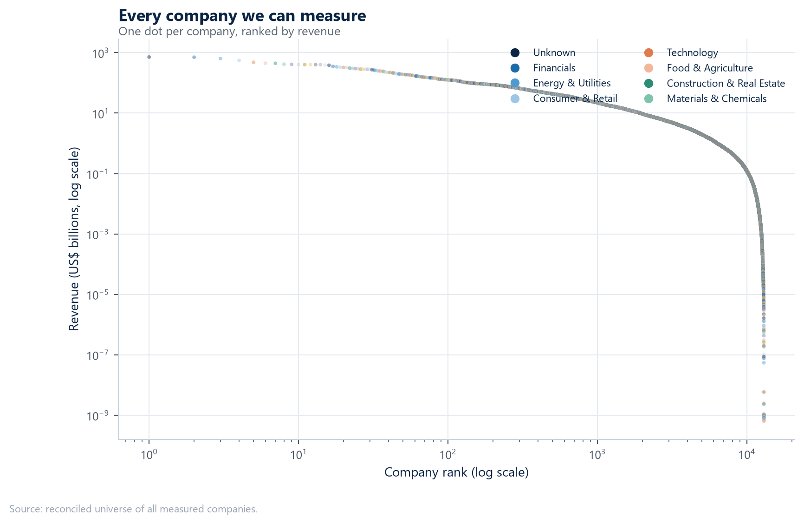
*Every company with a revenue figure, plotted on a log-log grid. The head is a handful of giants; the tail is tens of thousands of firms each too small to see in a ranked list.*

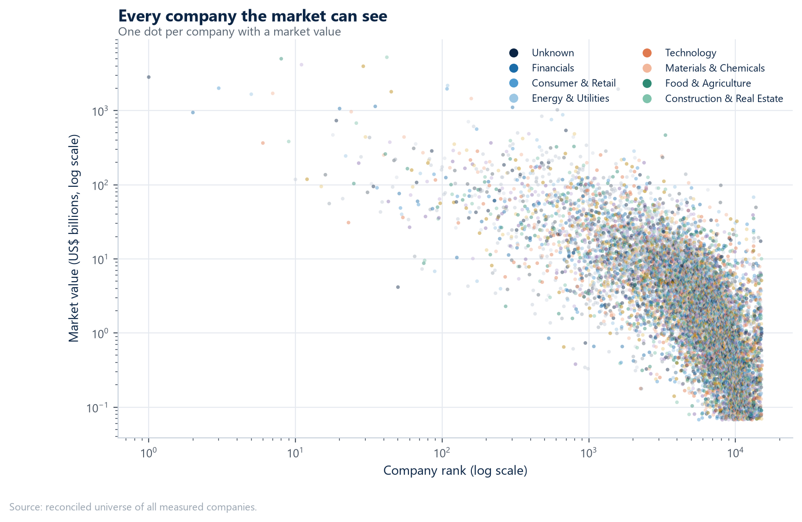
*The listed universe only: companies with a quoted price. The gap between the top of this cloud and the top of the revenue chart is the part of the corporate world that has no ticker.*

### The largest companies in the directory

**The largest companies in the directory**

| company | country | sector | ownership | revenue_usd | market_cap_usd |
|---|---|---|---|---|---|
| AMAZON.COM, INC. | United States | — | public | $717B | $2.8T |
| Walmart Inc. | United States | Consumer & Retail | public | $706B | $942B |
| Amazon | United States | Consumer & Retail | public | $638B | $2.0T |
| State Grid | — | — | state | $555B | — |
| Saudi Arabian Oil Company (Saudi Aramco) | Saudi Arabia | Energy & Utilities | public | $480B | $1.7T |
| UnitedHealth Group Incorporated | United States | — | public | $448B | $365B |
| Saudi Aramco | Saudi Arabia | — | public | $446B | $1.7T |
| Apple Inc. | United States | Technology | public | $416B | $5.0T |
| UnitedHealth Group | United States | Financials | public | $410B | $383B |
| McKESSON CORPORATION | United States | Healthcare | public | $403B | $118B |
| Alphabet Inc. | United States | Technology | public | $403B | $4.2T |
| CVS HEALTH CORPORATION | United States | Consumer & Retail | public | $402B | $119B |
| China National Petroleum | — | — | state | $402B | — |
| Vitol | World (private) | — | unknown | $400B | — |
| Sinopec | China | Energy & Utilities | public | $390B | $95B |
| PetroChina | China | Energy & Utilities | public | $384B | $136B |
| Volkswagen Group | Germany | Consumer & Retail | public | $351B | $56B |
| ExxonMobil | United States | Energy & Utilities | public | $340B | $470B |
| Exxon Mobil Corporation | United States | — | public | $332B | $733B |
| Samsung | South Korea | — | public | $326B | $1.1T |
| Cencora, Inc. | United States | Healthcare | public | $321B | $65B |
| Toyota Motor | Japan | Consumer & Retail | public | $309B | $244B |
| China State Construction Engineering | China | Construction & Real Estate | public | $303B | $31B |
| JPMorgan Chase | United States | — | public | $298B | $966B |
| Foxconn (Hon Hai Precision Industry) | Taiwan | — | public | $297B | $104B |

_Full table: `data/companies__company_directory.csv`_ (15,175 rows, 29 columns)._
# Appendix A: the datasets behind every number

Each row is one source file, what it measures, who publishes it and how much weight it was given.

**Dataset registry**

| Dataset | Kind | Trust | Publisher | File | Notes |
|---|---|---|---|---|---|
| Forbes Global 2000 2025 | financials | reported | Forbes | global2000_2025.csv | 2,000 largest firms by revenue. Revenue is a Forbes estimate in USD. |
| Forbes Global 2000 10-year history | financials | reported | Forbes | global2000_2025_history.csv | Long-format revenue/profit history, approx. 10 years. |
| Fortune Global 500 2025 | financials | reported | Fortune | fortune_g500_2025.csv | US-centric list; 500 firms ranked by revenue, USD millions. |
| Fortune ownership labels (manual) | reference | reported | manual correction | fortune_labels.csv | Corrects Fortune's company_type field, which mislabels state-owned firms as Private. |
| Companies master (Forbes + Fortune) | financials | reported | derived | companies_master.csv | Union of Forbes 2000 and Fortune 500 with manual ownership labels. |
| Industry taxonomy (13 sectors / 30 industries) | reference | reported | derived | industry_taxonomy.csv | Sector rollup of the Forbes 2000. |
| Country metadata (ISO3, region) | reference | reference | derived | country_meta.csv | 217 countries, 6 regions. |
| Country GDP 2024 | reference | authoritative | World Bank | country_gdp_2024.csv | Nominal GDP in current USD, 204 countries. |
| World macro series | reference | authoritative | World Bank | world_macro.csv | World aggregates: GDP, employment by sector, labour force, population. |
| Forbes America's Top Private Companies | financials | reported | Forbes | private_us_2025.csv | US only. Revenue reported by Forbes. |
| Forbes Cloud 100 + Next Billion | valuation | mark | Forbes | startups_2025.csv | Private valuations. Cloud 100 + Next Billion Dollar Startups. |
| Listed company universe | financials | authoritative/estimate | SEC XBRL + CompaniesMarketCap | listed_universe.csv | 12,512 listed firms. SEC revenue is audited; CMC revenue is an estimate. |
| Company profiles + descriptions | reference | mixed | Forbes + Wikipedia | company_profiles.csv | 20,663 profiles. Descriptions: Forbes (editorial) + Wikipedia (CC BY-SA). |
| Global stock exchanges | valuation | reported | CompaniesMarketCap | exchanges.csv | 60 exchanges. Market cap totals are coverage-limited, not world totals. |
| Top companies per exchange | valuation | reported | CompaniesMarketCap | exchange_top_companies.csv | Top ~10 firms per exchange. |
| Companies per exchange | valuation | reported | CompaniesMarketCap | exchange_companies.csv | 9,780 firm-exchange rows. ADRs mapped to home exchange. |
| Ticker suffix to exchange map | reference | reference | derived | exchanges_lookup.csv | Maps ticker suffixes to exchanges. |
| Unicorn company list (CB Insights) | valuation | mark | CB Insights | unicorns_cbinsights.csv | 1,442 private companies with $1B+ valuations. Paper marks, not prices. |
| Startups global (CB Insights + Forbes) | valuation | mark | CB Insights / Forbes | startups_global.csv | 1,479 rows, merged and de-duplicated. |
| AI model builders | reference | mixed | compiled | ai_companies.csv | 173 companies across 15 modalities. |
| AI labs | reference | mixed | compiled | ai_labs.csv | 99 labs. Open/closed weight status, HF org, valuation. |
| Hugging Face org stats | reference | reported | Hugging Face | hf_stats.csv | Model counts and top-model downloads per org. |
# Appendix B: chart index

Every chart is written to `charts/` next to this document.

**Charts**

| # | Title | Subtitle | File |
|---|---|---|---|
| 01 | The twenty largest companies on earth | Revenue, 2025 — Forbes Global 2000 | charts/01_top20_revenue.png |
| 02 | How many firms clear each revenue bar | Cumulative count above a revenue threshold | charts/02_revenue_thresholds.png |
| 03 | The rank-size curve | Revenue against rank, both on a log scale | charts/03_rank_size_zipf.png |
| 04 | What Forbes' list leaves out | Largest measured companies absent from the Global 2000 | charts/04_truncation_gap.png |
| 05 | Where the world's corporate revenue is booked | Top 20 countries by measured revenue | charts/05_top_countries.png |
| 06 | Corporate weight against economic weight | Revenue share against GDP share | charts/06_revenue_vs_gdp.png |
| 07 | Six regions, one world | Measured revenue by region | charts/07_regions.png |
| 08 | What mixing in the other lists changes | Forbes-only versus reconciled regional shares | charts/08_region_compare.png |
| 09 | Revenue and profit by sector | Where the money comes from, and where it stays | charts/09_sector_revenue_profit.png |
| 10 | Median net margin by sector | The middle firm in each sector | charts/10_sector_margin.png |
| 11 | How wide is the margin spread inside each sector? | 10th to 90th percentile net margin | charts/11_margin_dispersion.png |
| 12 | Every sector is margin-driven or turnover-driven | Net margin against asset turnover | charts/12_roa_decomposition.png |
| 13 | Concentration inside each sector | Herfindahl index on revenue | charts/13_sector_concentration.png |
| 14 | Who owns the world's corporate revenue? | Revenue by ownership type | charts/14_ownership_mix.png |
| 15 | The invisible giants | Measured companies missing from the Global 2000 | charts/15_invisible_giants.png |
| 16 | The true top 100 on earth | Re-ranked from the reconciled universe | charts/16_true_top100.png |
| 17 | Median net margin, owner by owner | State, listed, private and mutual businesses | charts/17_margin_by_ownership.png |
| 18 | The twenty most valuable listed companies | Market capitalisation | charts/18_top_listed.png |
| 19 | What the market pays for each unit of revenue | Market capitalisation ÷ revenue, by sector | charts/19_multiples_by_sector.png |
| 20 | Profit and market value disagree about what matters | Profit share minus market-value share, by sector | charts/20_profit_vs_mcap.png |
| 21 | How deep is each equity market? | Market capitalisation as a multiple of GDP | charts/21_financial_depth.png |
| 22 | The world's exchanges by market value | Aggregate market capitalisation per venue | charts/22_exchanges.png |
| 23 | Where the private giants are | Unicorn paper valuation by country | charts/23_unicorns_country.png |
| 24 | Which industries the private money went into | Unicorn paper valuation by industry | charts/24_unicorns_industry.png |
| 25 | The unicorn wave | Companies crossing $1B each year | charts/25_unicorn_wave.png |
| 26 | Real revenue with no listed share | Measured revenue, no public equity | charts/26_unlisted_top.png |
| 27 | The AI builders by modality | Model builders grouped by what they build | charts/27_ai_modality.png |
| 28 | The constant cohort | Revenue of a fixed set of companies over time | charts/28_cohort_revenue.png |
| 29 | Did the cohort get more profitable? | Net margin of a fixed cohort | charts/29_cohort_margin.png |
| 30 | Who grew, who shrank | Revenue change for the same companies over time | charts/30_rank_mobility.png |
| 31 | Where the profit pool moved | Change in industry share of total profit | charts/31_profit_pool_migration.png |
| 32 | Where the data is thin | Share of empty cells in key fields | charts/32_missingness.png |
| 33 | How much to trust each row | Distribution of the confidence score | charts/33_confidence.png |
| 34 | Do the sources agree? | Median revenue disagreement between source pairs | charts/34_cross_source.png |
| 35 | Every company we can measure | One dot per company, ranked by revenue | charts/35_every_company_we_can_measure.png |
| 36 | Every company the market can see | One dot per company with a market value | charts/36_every_company_the_market_can_see.png |
# Appendix C: table index

Every table the engine produced, written as CSV.

**Tables**

| Module | Table | Rows | Columns | File |
|---|---|---|---|---|
| scale | top_beyond_forbes | 25 | company, country, revenue_musd, sector | data/scale__top_beyond_forbes.csv |
| scale | thresholds | 6 | threshold, firms | data/scale__thresholds.csv |
| scale | top20 | 20 | company, country, revenue_usd, profit_usd, market_cap_usd | data/scale__top20.csv |
| scale | rank_size | 2,000 | rank, company, country, revenue_usd | data/scale__rank_size.csv |
| geography | country_forbes | 61 | country_iso3, companies, revenue_usd, profit_usd, market_cap_usd, employees, country, region, profit_margin, revenue_per_employee... | data/geography__country_forbes.csv |
| geography | country_mixed | 84 | country_iso3, companies, revenue_usd, profit_usd, market_cap_usd, employees, country, region, profit_margin, revenue_per_employee... | data/geography__country_mixed.csv |
| geography | regions_forbes | 6 | region, countries, companies, revenue_usd, profit_usd, market_cap_usd, employees, revenue_share, profit_margin, revenue_per_employee... | data/geography__regions_forbes.csv |
| geography | regions_mixed | 6 | region, countries, companies, revenue_usd, profit_usd, market_cap_usd, employees, revenue_share, profit_margin, revenue_per_employee... | data/geography__regions_mixed.csv |
| geography | map | 84 | country_iso3, country, region, companies, revenue_musd, profit_musd, market_cap_musd, employees, profit_margin | data/geography__map.csv |
| geography | over_under | 55 | country, companies, revenue_usd, gdp_usd, revenue_share, gdp_share, index_vs_gdp | data/geography__over_under.csv |
| industry | sectors | 13 | sector, companies, revenue_usd, profit_usd, assets_usd, market_cap_usd, employees, profit_margin, roa, asset_turnover... | data/industry__sectors.csv |
| industry | industries | 30 | industry_canon, companies, revenue_usd, profit_usd, assets_usd, market_cap_usd, employees, profit_margin, roa, asset_turnover... | data/industry__industries.csv |
| industry | margin_dispersion | 13 | sector, firms, mean, median, p10, p90, std, iqr, cv, loss_makers... | data/industry__margin_dispersion.csv |
| industry | valuation_by_sector | 13 | sector, firms, median_ps, revenue, market_cap | data/industry__valuation_by_sector.csv |
| industry | sector_concentration | 13 | sector, firms, hhi, top5_share, gini | data/industry__sector_concentration.csv |
| ownership | ownership_forbes | 1 | ownership, companies, revenue_usd, profit_usd, market_cap_usd, employees, profit_margin, revenue_per_employee, revenue_share, profit_share | data/ownership__ownership_forbes.csv |
| ownership | ownership_mixed | 6 | ownership, companies, revenue_usd, profit_usd, market_cap_usd, employees, profit_margin, revenue_per_employee, revenue_share, profit_share | data/ownership__ownership_mixed.csv |
| ownership | invisible_giants | 200 | company_key, company, source, source_group, list_name, rank_in_source, country, country_iso3, region, city... | data/ownership__invisible_giants.csv |
| ownership | invisible_by_country | 82 | country, firms, revenue_usd | data/ownership__invisible_by_country.csv |
| ownership | true_top100 | 100 | company_key, company, source, source_group, list_name, rank_in_source, country, country_iso3, region, city... | data/ownership__true_top100.csv |
| ownership | margin_tests | 3 | comparison, n_a, n_b, mean_a, mean_b, median_a, median_b, diff, ci_low, ci_high... | data/ownership__margin_tests.csv |
| capital | exchanges | 60 | exchange, exchange_country, city, companies, total_market_cap_usd, top10_market_cap_usd, top_company, top_company_mcap, top10_share, avg_company_cap... | data/capital__exchanges.csv |
| capital | multiples_by_sector | 1 | sector, firms, median_ps, p25_ps, p75_ps, total_market_cap, total_revenue | data/capital__multiples_by_sector.csv |
| capital | profit_pool | 13 | sector, revenue, profit, market_cap, profit_share, market_cap_share, profit_minus_mcap_pp, market_cap_to_profit | data/capital__profit_pool.csv |
| capital | financial_depth | 74 | country, market_cap, companies, iso3, gdp, mcap_to_gdp | data/capital__financial_depth.csv |
| capital | top_listed | 100 | company, country, sector, market_cap_usd, revenue_usd, revenue_basis | data/capital__top_listed.csv |
| private_capital | unicorns_by_country | 55 | country, region, companies, valuation_usd | data/private_capital__unicorns_by_country.csv |
| private_capital | unicorns_by_industry | 7 | industry, companies, valuation_usd | data/private_capital__unicorns_by_industry.csv |
| private_capital | unicorns_top | 20 | company, country, industry, valuation_busd, date_joined | data/private_capital__unicorns_top.csv |
| private_capital | private_us | 60 | company, industry, revenue_usd, employees | data/private_capital__private_us.csv |
| private_capital | unlisted_top | 100 | company, country, ownership, sector, revenue_usd | data/private_capital__unlisted_top.csv |
| private_capital | unicorns_by_year | 16 | year, companies, valuation_usd | data/private_capital__unicorns_by_year.csv |
| private_capital | ai_by_modality | 59 | modality, companies | data/private_capital__ai_by_modality.csv |
| time_series | cohort_revenue_series | 10 | year, total, n | data/time_series__cohort_revenue_series.csv |
| time_series | cohort_profit_series | 10 | year, total, n | data/time_series__cohort_profit_series.csv |
| time_series | cohort_margin_path | 10 | year, total_rev, total_prof, margin_pct | data/time_series__cohort_margin_path.csv |
| time_series | profit_pool_migration | 38 | industry, revenue_start_musd, revenue_end_musd, revenue_cagr_pct, profit_start_musd, profit_end_musd, profit_cagr_pct, profit_share_end_pct, profit_share_start_pct, profit_share_change_pp | data/time_series__profit_pool_migration.csv |
| time_series | rank_mobility | 1,287 | company, revenue_start_musd, revenue_end_musd, growth_pct | data/time_series__rank_mobility.csv |
| time_series | mobility_forbes | 1,287 | company, rank_now, growth_pct | data/time_series__mobility_forbes.csv |
| data_quality | missingness | 186 | dataset, column, rows, missing, missing_pct, distinct | data/data_quality__missingness.csv |
| data_quality | missingness_key | 34 | dataset, column, rows, missing, missing_pct, distinct | data/data_quality__missingness_key.csv |
| data_quality | cross_source_disagreement | 9 | source_a, source_b, pairs, median_abs_pct_diff, mean_abs_pct_diff, p90_abs_pct_diff, share_within_10pct, share_within_25pct, share_over_2x, pearson_r... | data/data_quality__cross_source_disagreement.csv |
| data_quality | confidence | 200 | company, revenue_basis, n_sources, confidence_score | data/data_quality__confidence.csv |
| data_quality | data_vintages | 3 | dataset, min_year, max_year, mode_year | data/data_quality__data_vintages.csv |
| companies | company_directory | 15,175 | company, country, country_iso3, region, sector, industry_canon, ownership, source, list_name, n_sources... | data/companies__company_directory.csv |
| companies | company_presence | 15,175 | company, country_iso3, sector, ownership, source, revenue_usd, market_cap_usd, employees, rank_by_revenue | data/companies__company_presence.csv |
# Appendix D: caveats
- {'topic': 'Revenue is a flow, not value added', 'detail': 'Company revenue double-counts intermediate goods across the supply chain. Global 2000 revenue equals ~47% of world GDP only as a scale statement.'}
- {'topic': "Fortune's company_type mislabels state firms", 'detail': "Fortune reports several Chinese state enterprises as 'Private'. Ownership for 104 names was hand-labelled in data/fortune_labels.csv and applied here."}
- {'topic': 'Exchange market caps are not world market cap', 'detail': 'The 60 exchanges cover ~148T USD, but listed domestic companies number ~48,000 worldwide, so this is a coverage figure, not a total.'}
- {'topic': 'Unicorn valuations are marks, not prices', 'detail': 'Private valuations are the price of the most recent round, usually preferred stock with a preference. They are not realisable and not comparable to market capitalisation.'}
- {'topic': 'The listed universe is US-complete and world-partial', 'detail': '5,500 US names carry SEC XBRL revenue; the rest carry a market-cap-site estimate. Country counts measure coverage, not corporate density.'}
- {'topic': 'Market-value snapshots come from different dates', 'detail': 'Forbes values are May 2025; the scraped Fortune profiles are dated 2026. They are never plotted on the same axis.'}

Generated by `data_analysis/build_report.py`.
